# State of the Art in Semantic Query Processing Engines (SQPEs)

_Last updated: October 23, 2026. See the [Changelog](#changelog)._

## Scope

This document surveys **Semantic Query Processing Engines (SQPEs)** in the recent AI and data-management sense: systems that extend SQL, relational algebra, dataframe APIs, or declarative dataflow languages with **semantic operators** powered by LLMs, embedding models, multimodal models, learned proxy models, or retrieval systems.

This is different from the older Semantic Web use of "semantic query" over RDF/SPARQL and ontologies. That older line of work is still relevant for enterprise semantics, schema mediation, and provenance, but the focus here is the newer wave of systems that make semantic reasoning over text, images, audio, documents, and hybrid structured/unstructured data available through declarative query interfaces.

Representative systems and artifacts include [LOTUS](https://arxiv.org/abs/2407.11418), [UQE](https://arxiv.org/abs/2407.09522), [Palimpzest](https://arxiv.org/abs/2405.14696), [DocETL](https://arxiv.org/abs/2410.12189), [SemBench](https://arxiv.org/abs/2511.01716), [LROBench](https://arxiv.org/abs/2603.02537), [Spider 2.0-AIFunc](https://arxiv.org/abs/2607.06229), [The Stochastic Shift](https://arxiv.org/abs/2609.21133), [HybridDeepResearch](https://arxiv.org/abs/2609.09410), [Kalypso](https://arxiv.org/abs/2607.23815), [DASE](https://arxiv.org/abs/2609.19491), [FFX](https://arxiv.org/abs/2609.09002), [NousDB](https://arxiv.org/abs/2610.28551), [JEVDB](https://arxiv.org/abs/2610.02046), [SemViews](https://arxiv.org/abs/2610.12768), [Same Query, Different Answer](https://arxiv.org/abs/2610.13823), [SemBaker](https://arxiv.org/abs/2608.06677), [UDA-Bench](https://arxiv.org/abs/2510.27119), [Google's AI query approximation work](https://doi.org/10.1145/3802002), [Snowflake Cortex AISQL](https://arxiv.org/abs/2511.07663), [Sema](https://arxiv.org/abs/2603.11622), [iPDB](https://arxiv.org/abs/2601.16432), [Horrila](https://arxiv.org/abs/2604.09944), [FlockMTL](https://arxiv.org/abs/2504.01157), [SUQL](https://arxiv.org/abs/2311.09818), and product offerings such as [BigQuery ML and generative AI](https://cloud.google.com/bigquery/docs/bqml-introduction), [Snowflake Cortex](https://docs.snowflake.com/en/user-guide/snowflake-cortex), and [Databricks Mosaic AI / SQL AI functions](https://docs.databricks.com/aws/en/sql/language-manual/functions/ai_query).

---

## Executive summary

The state of the art is converging around one central idea:

> **AI operators are becoming first-class database operators.**

Instead of treating LLM calls as opaque UDFs, recent systems expose semantic operations as declarative query operators with logical semantics, physical implementations, cost models, selectivity behavior, quality constraints, caching opportunities, sampling strategies, and optimizer rules.

The field is moving from simple SQL functions that call LLMs row by row toward full **AI-native query processing**. The key trends are:

1. **Declarative semantic operators.** Systems such as [LOTUS](https://arxiv.org/abs/2407.11418), [UQE](https://arxiv.org/abs/2407.09522), [Sema](https://arxiv.org/abs/2603.11622), and [Snowflake Cortex AISQL](https://arxiv.org/abs/2511.07663) introduce semantic filters, maps, joins, ranks, aggregations, and classifications.

2. **Query optimization for expensive model calls.** Systems optimize LLM calls through batching, caching, deduplication, operator reordering, prompt rewriting, sampling, model cascading, proxy models, and semantic join rewrites.

3. **Query-aware execution and serving.** [Kalypso](https://arxiv.org/abs/2607.23815) shows that after the optimizer has reduced or reorganized model calls, the serving layer itself can still be a major bottleneck. It introduces relational LLM serving: a layer that receives semantic query plans, pipelines dependent operators, and preserves reusable KV-cache prefixes across operators under GPU memory pressure. [FFX](https://arxiv.org/abs/2609.09002) adds a complementary execution-engine angle: factorized join intermediates can be serialized compactly into LLM prompts, reducing token cost for semantic operators over join-heavy results.

4. **Approximation and model substitution.** [UQE](https://arxiv.org/abs/2407.09522) and the Google proxy-model paper, [100x Cost & Latency Reduction](https://doi.org/10.1145/3802002), show that many semantic filters and ranking tasks can be approximated by lightweight models over embeddings. [Snowflake Cortex AISQL](https://arxiv.org/abs/2511.07663) similarly uses AI-aware optimization, cascades, and semantic join reformulations.

5. **Declarative AI pipelines beyond SQL.** [Palimpzest](https://arxiv.org/abs/2405.14696) and [DocETL](https://arxiv.org/abs/2410.12189) treat unstructured-data analysis pipelines as optimizable declarative workflows rather than handwritten LLM orchestration code.

6. **Benchmarking is catching up.** [SemBench](https://arxiv.org/abs/2511.01716) targets end-to-end SQPE behavior across modalities, scenarios, and operator types. [LROBench](https://arxiv.org/abs/2603.02537) complements it with a relation-native, operator-level benchmark for LLM-enhanced relational operators and access-path variants. [Spider 2.0-AIFunc](https://arxiv.org/abs/2607.06229) adds a front-end layer: it tests whether text-to-SQL models and agents can generate AI-native SQL workflows that correctly use platform AI functions such as Snowflake Cortex `AI_CLASSIFY`, `AI_FILTER`, `AI_SIMILARITY`, `AI_EXTRACT`, `AI_AGG`, and `AI_SENTIMENT`. [The Stochastic Shift](https://arxiv.org/abs/2609.21133) argues that such workflows also need new evaluation methodology because strict execution equality can falsely reject semantically valid AI-operator queries.

7. **Hybrid structured/unstructured access is a core use case.** [SUQL](https://arxiv.org/abs/2311.09818), [Binder](https://arxiv.org/abs/2210.02875), and product systems address the need to combine SQL-style access over structured data with semantic reasoning over free text or multimodal fields.

8. **Industrial systems are no longer just wrappers.** Google, Snowflake, Databricks, and other data platforms are embedding AI capabilities inside SQL engines, warehouses, lakehouses, and HTAP systems. Snowflake and Google now have research papers describing production-oriented AI query engines and cost/latency optimization.

9. **Semantic prefiltering and evidence linking are becoming SQPE-adjacent execution substrates.** [DASE](https://arxiv.org/abs/2609.19491) shows that many agentic and scientific-discovery workloads can be served by a relational engine that combines structured filters, multiple vector scores, exact joins, and thresholded embedding-similarity joins, returning high-recall candidates for downstream semantic operators.

10. **Evaluation and optimization are becoming first-class product features.** Snowflake's `AI_FUNCTION_EVALUATION` and `AI_FUNCTION_OPTIMIZATION` previews show a product trend toward measuring quality, cost, token usage, nondeterminism, and prompt/model trade-offs inside the data platform rather than only in external notebooks.

11. **The research frontier is shifting to optimizers.** The hardest open problems are not just adding more AI functions. They are deciding when to call which model, where to place semantic operators in a plan, how to estimate quality/cost/selectivity, how to provide guarantees, and how to preserve provenance and auditability.
12. **Reuse across queries needs certification, not semantic similarity alone.** [SemViews](https://arxiv.org/abs/2610.12768) treats prior semantic-filter labels as provenance-bearing semantic views. They influence planning, while fresh stratified oracle samples certify precision and recall. This separates performance benefits of reuse from potentially unsafe assumptions of entailment or identical behavior across paraphrases.

13. **Different execution substrates deserve distinct physical plans.** [NousDB](https://arxiv.org/abs/2610.28551) brings token-aware statistics, fidelity-tested batching, repartitioning, and relational rewrites to a DataFusion engine; [JEVDB](https://arxiv.org/abs/2610.02046) replaces many autoregressive yes/no and ranking calls with typed decision models plus semantic-join candidate pruning; [SemBaker](https://arxiv.org/abs/2608.06677) compiles suitable natural-language operators to executable local code.

14. **Reproducibility is distinct from answer quality.** [Same Query, Different Answer](https://arxiv.org/abs/2610.13823) shows that temperature-zero operators can change individual decisions and therefore whole relational query answers, even when an aggregate accuracy score changes little. Evaluating SQPEs now requires repeated item-level, answer-level, and quality-level measurements.


---

## Working definition of SQPE

A **Semantic Query Processing Engine** is a data system that supports declarative queries involving semantic operations whose evaluation depends on learned models, LLMs, embeddings, multimodal models, retrieval models, or symbolic/semantic knowledge.

A useful working definition:

> An SQPE is a query-processing system that extends a declarative data interface with semantic operators and provides some combination of logical planning, physical execution, optimization, approximation, quality control, provenance, and integration with model-serving infrastructure.

The interface may be:

- SQL or SQL-like language, as in [UQE](https://arxiv.org/abs/2407.09522), [SemaSQL](https://arxiv.org/abs/2603.11622), [SUQL](https://arxiv.org/abs/2311.09818), [Snowflake Cortex AISQL](https://arxiv.org/abs/2511.07663), and BigQuery-style AI queries.
- DataFrame or relational-style API, as in [LOTUS](https://arxiv.org/abs/2407.11418).
- Declarative dataflow or pipeline specification, as in [Palimpzest](https://arxiv.org/abs/2405.14696) and [DocETL](https://arxiv.org/abs/2410.12189).
- A meta-interface over multiple semantic engines, as in [Meta Engine](https://arxiv.org/abs/2602.01701).
- A query-aware model-serving interface for semantic plans, as in [Kalypso](https://arxiv.org/abs/2607.23815), where the user-facing SQPE may still be LOTUS, Palimpzest, Sema, Snowflake, or another engine, but the LLM serving substrate becomes aware of operator dependencies, pipelining, and KV-cache reuse.

---

## Conceptual landscape

```mermaid
graph TD
    SQPE[Semantic Query Processing Engines]

    SQPE --> SQL[SQL-native AI extensions]
    SQPE --> REL[Semantic relational/dataframe operators]
    SQPE --> PIPE[Declarative AI dataflows]
    SQPE --> HYBRID[Hybrid structured and unstructured query languages]
    SQPE --> PROD[Production cloud data platforms]
    SQPE --> BENCH[Benchmarks and evaluation]
    SQPE --> META[Meta-engines and routing]
    SQPE --> SERVE[Query-aware LLM serving]

    SQL --> UQE[UQE / UQL]
    SQL --> SEMA[Sema / SemaSQL]
    SQL --> IPDB[iPDB / Predict operator]
    SQL --> HORRILA[Horrila]
    SQL --> FLOCK[FlockMTL / DuckDB]

    REL --> LOTUS[LOTUS semantic operators]
    REL --> BINDER[Binder neural-symbolic SQL/Python]

    PIPE --> PAL[Palimpzest]
    PIPE --> DOCETL[DocETL]
    PIPE --> EVAP[EVAPORATE]

    HYBRID --> SUQL[SUQL]
    HYBRID --> DIR[dIR and related systems]

    PROD --> BQ[Google BigQuery / AlloyDB AI queries]
    PROD --> SNOW[Snowflake Cortex AISQL]
    PROD --> DBX[Databricks SQL AI functions]

    BENCH --> SEMBENCH[SemBench]
    BENCH --> LROBENCH[LROBench]
    BENCH --> SPIDERAIFUNC[Spider 2.0-AIFunc]

    SERVE --> KALYPSO[Kalypso]
    SERVE --> PREFIX[KV-cache / prefix reuse]
    SERVE --> VLLM[vLLM and SGLang substrate]

    META --> METAENGINE[Meta Engine]
```


### Optimizer-centric frontier map

More recent work suggests a more detailed optimizer-centric map of the SQPE frontier:

```mermaid
flowchart TD
    SQPE[Semantic Query Processing Engines]

    SQPE --> OP[Semantic operator instances]
    SQPE --> PLAN[Operator and plan optimization]
    SQPE --> AQP[Approximate query processing]
    SQPE --> PROD[Production AI SQL]
    SQPE --> SERVE[Query-aware LLM serving]

    OP --> FILTER[Semantic Filter / AI_FILTER]
    OP --> JOIN[Semantic Join / AI_JOIN]
    OP --> ORDER[Semantic ORDER BY / AI_RANK]
    OP --> DAG[Task-specific operator DAGs]
    OP --> LRO[LRO taxonomy / LROBench]

    FILTER --> FAST[Fast LLM-Based Semantic Filtering]
    FILTER --> LARCH[Larch]
    FILTER --> SCALE[ScaleDoc / CSV / BARGAIN]

    JOIN --> FDJ[Featurized-Decomposition Join]
    JOIN --> SEMJOIN[SemJoin strategy routing]
    JOIN --> ABJ[Adaptive Block Join]
    JOIN --> BAS[BaS / Weighted Wander Join]

    ORDER --> ACCESS[LLM ORDER BY access paths]
    ORDER --> LOTUSORDER[LOTUS semantic sort]
    ORDER --> BQRANK[BigQuery AI.RANK]

    DAG --> CADENZA[CADENZA / TxRA]
    DAG --> DOCETL[DocETL rewrites]
    DAG --> PAL[Palimpzest]
    DAG --> ABACUS[Abacus]

    PLAN --> HORRILA[PLOP / Horrila placement]
    PLAN --> QUEST[Quest]
    PLAN --> IPDB[iPDB]
    PLAN --> PROMPTS[Prompts as first-class citizens]

    AQP --> QCAI[Query-centric AI workflows]
    AQP --> ONLINE[Online aggregation]
    AQP --> WANDER[Wander Join]
    AQP --> THALAMUS[ThalamusDB]

    PROD --> SNOW[Snowflake Cortex AISQL]
    PROD --> GOOGLE[BigQuery / AlloyDB AI queries]
    PROD --> IPDB2[iPDB / DuckDB]
    PROD --> DBX[Databricks AI functions]

    SERVE --> KALYPSO[Kalypso]
    SERVE --> PIPELINE[Pipeline stages and tasks]
    SERVE --> CACHE[Cross-operator KV-cache reuse]
    SERVE --> GPU[GPU memory-aware scheduling]
```

---

## Reference architecture

A modern SQPE can be viewed as a stack with six layers:

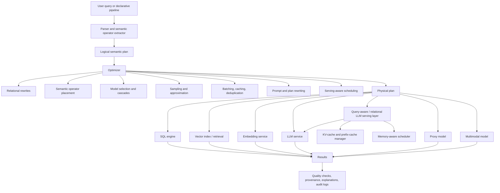

The key architectural distinction from a simple LLM UDF system is the optimizer. In a UDF-only system, the database sees an opaque function call. In an SQPE, the system understands that the operation is a semantic filter, join, ranking, extraction, classification, mapping, or aggregation and can optimize accordingly.

Recent work adds another architectural distinction: the model-serving layer may also need to understand the semantic query plan. Kalypso argues that reducing the number of LLM calls is not enough when remaining calls still dominate runtime. A serving-aware SQPE can expose operator dependencies, pipeline boundaries, predicate behavior, and Cartesian-product structure to a relational LLM serving layer so that it can preserve reusable KV-cache prefixes and schedule dependent work under GPU memory constraints.

---

## Core semantic operators

Most SQPEs can be described using a small set of semantic operators.

| Operator | Informal meaning | Example systems |
|---|---|---|
| Semantic filter | Keep rows satisfying a natural-language condition | UQE, LOTUS, BigQuery AI.IF, Snowflake AISQL, Sema |
| Semantic map/extract | Produce a new field from text/image/audio/document content | Palimpzest, DocETL, BigQuery ML.GENERATE_TEXT, Snowflake Cortex, Databricks ai_query |
| Semantic classify | Assign labels using instructions or examples | Google proxy-model paper, Snowflake AISQL, LOTUS, Databricks AI functions |
| Semantic rank | Rank records by natural-language relevance or rubric | LOTUS, Google AI.RANK, UQE, Snowflake AISQL |
| Semantic join | Join records using semantic compatibility rather than equality | LOTUS, Snowflake AISQL, Horrila, Sema |
| Semantic aggregation | Aggregate over semantic conditions or extracted attributes | UQE, LOTUS, FlockMTL, Palimpzest |
| Semantic search / retrieval | Retrieve relevant records or documents using embedding or hybrid retrieval | SUQL, FlockMTL, BigQuery vector search, Snowflake Cortex Search, Databricks vector search |
| Summarization / reduction | Summarize groups, documents, or result sets | FlockMTL, DocETL, Palimpzest, Snowflake Cortex, Databricks ai_query |
| Multimodal predicates | Evaluate conditions over images/audio/video plus structured data | SemBench, UQE, BigQuery object tables plus generative AI workflows |

---

## Example SQPE-style SQL

The following is representative of the direction, not a standardized syntax:

```sql
SELECT customer_id, review_text
FROM reviews
WHERE AI_IF(
  review_text,
  'The customer complains about comfort or fit.'
)
ORDER BY AI_RANK(
  review_text,
  'How severe is the product-quality complaint?'
) DESC
LIMIT 20;
```

A naive implementation calls an LLM once per row per operator. The state of the art tries to avoid that through:

- vector prefiltering,
- sampling,
- proxy models,
- model cascades,
- batching,
- caching,
- deduplication,
- semantic operator reordering,
- prompt compression,
- plan rewriting,
- adaptive execution,
- and selective fallback to stronger models.

---

## Main system families

### 1. SQL-native semantic query engines

These systems keep SQL as the main interface and add semantic operators, functions, or clauses.

#### UQE: A Query Engine for Unstructured Databases

[UQE](https://arxiv.org/abs/2407.09522) is one of the most directly relevant systems for SQPEs. It introduces **UQL**, a SQL dialect that allows natural-language conditions and operators over unstructured data.

Key ideas:

- SQL-like declarative interface for unstructured data.
- Natural-language predicates for semantic filtering.
- Semantic retrieval and abstraction aggregation.
- Conditional aggregation over unstructured content.
- Sampling and compiler-inspired orchestration to reduce foundation-model calls.
- Embedding-based proxy models for efficient semantic filtering.

Why it matters:

UQE is a foundational paper because it frames unstructured data analytics as query processing, not just retrieval or ad hoc LLM prompting. It is also a direct predecessor to the recent Google proxy-model work, which revisits and scales the proxy-model idea for BigQuery and AlloyDB-style settings.

#### Sema: A high-performance system for LLM-based semantic query processing

[Sema](https://arxiv.org/abs/2603.11622) is a DuckDB-based semantic query engine that introduces **SemaSQL**, a SQL dialect for injecting natural-language semantic expressions into standard SQL clauses.

Key ideas:

- Semantic operators as first-class query operators, not opaque UDFs.
- Logical optimization that compresses natural-language expressions and derives relational constraints from semantic predicates.
- Runtime adaptive query execution that can reorder operators, fuse semantic operations, and apply prompt batching.
- Optimization objective balancing token cost, latency, and accuracy.

Why it matters:

Sema is important because it attacks the core DBMS integration problem: how to expose semantic operations through SQL while still allowing the optimizer to reason about them.

#### Horrila: cost-based placement of semantic operators

[Horrila](https://arxiv.org/abs/2604.09944) focuses on where semantic operators should be placed in hybrid relational/semantic query plans.

Key ideas:

- Queries combine traditional relational operators with expensive semantic operators.
- Placing a semantic filter early can reduce downstream relational work but may cause more LLM calls.
- Placing it later can reduce LLM calls via deduplication or caching but can increase relational intermediate sizes.
- Horrila reduces planning to semantic filter placement and uses a dynamic-programming cost model.

Why it matters:

Horrila is one of the clearest examples of SQPE research returning to classic query optimization questions under new cost models. It treats LLM cost and relational cost as jointly optimized plan components.

#### FlockMTL / Beyond Quacking

[FlockMTL](https://arxiv.org/abs/2504.01157) integrates LLM and RAG capabilities deeply into DuckDB.

Key ideas:

- Model-driven scalar and aggregate functions.
- Chained predictions through tuple-level mappings and reductions.
- `PROMPT` and `MODEL` as first-class schema objects, analogous to `TABLE`.
- Cost-based optimizations such as batching and caching.
- Resource independence for model-backed SQL applications.

Why it matters:

FlockMTL is valuable because it explores what it means for models and prompts to become part of the database catalog and query optimization surface.

#### iPDB: in-database ML and LLM predicates inside SQL

[iPDB](https://arxiv.org/abs/2601.16432) is a DuckDB-based relational system that brings ML and LLM inference into SQL through native language extensions and engine-level support, rather than treating inference as an ordinary black-box UDF.

Key ideas:

- **Model catalog and model DDL.** Users can register remote LLMs, local LLMs, and tabular ML models with `CREATE LLM MODEL` or `CREATE TABULAR MODEL`; the catalog stores paths, API endpoints, input/output attributes, model options, and binding metadata.
- **SQL clauses for inference.** iPDB adds `LLM` and `PREDICT` clauses that can appear as scalar inference, table inference, or table generation. This lets model inference appear naturally in `SELECT`, `FROM`, `WHERE`, `JOIN`, `GROUP BY`, and `ORDER BY` contexts.
- **Relational predict operator.** iPDB introduces an inference operator, denoted as a relational algebra operator `δ`, and specializes it into semantic project, semantic select, semantic relation/table generation, and semantic join operators.
- **Schema-compliant structured outputs.** Because SQL requires typed columns, iPDB rewrites prompts and uses structured output generation, including grammar-constrained decoding for local models and JSON-schema-style guided generation for remote models.
- **Physical execution in DuckDB.** iPDB extends DuckDB's parser, binder, logical planner, optimizer, and vectorized execution engine with `LogicalPredict`, `PhysicalPredict`, `PredictScan`, and `PredictExpression` paths. Executors include ONNX Runtime for tabular models, Llama.cpp for local LLMs, and OpenAI-compatible APIs for remote LLMs.
- **Inference-specific optimizations.** The main optimizations are prompt deduplication, multi-row prompt marshaling, parallel LLM calls, semantic predicate ordering, semantic select-vs-join ordering, and semantic predicate merging.

Why it matters:

Compared with systems such as LOTUS and Palimpzest, iPDB is more tightly centered on **SQL-native relational integration**: it keeps ordinary SQL, relational joins, grouping, and projection in the same engine as semantic inference. Compared with generic UDF systems, the optimizer can reason about inference cost, typed outputs, batching, deduplication, and whether a semantic predicate should be pulled above a join or merged with another semantic predicate.

A useful way to position iPDB is as the **engine-integration counterpart** to operator-specific semantic optimizers:

- Larch learns how to order multiple semantic filters.
- Fast LLM-Based Semantic Filtering designs a better physical semantic-filter cascade.
- SemJoin, FDJ, and BaS specialize semantic joins.
- Access Paths for LLM ORDER BY specializes semantic ranking/sorting.
- CADENZA decomposes a semantic operator instance into a task DAG.
- **iPDB shows how these semantic operations can be embedded in a conventional SQL engine with a model catalog, typed inference outputs, physical predict operators, and relational-plan rewrites.**

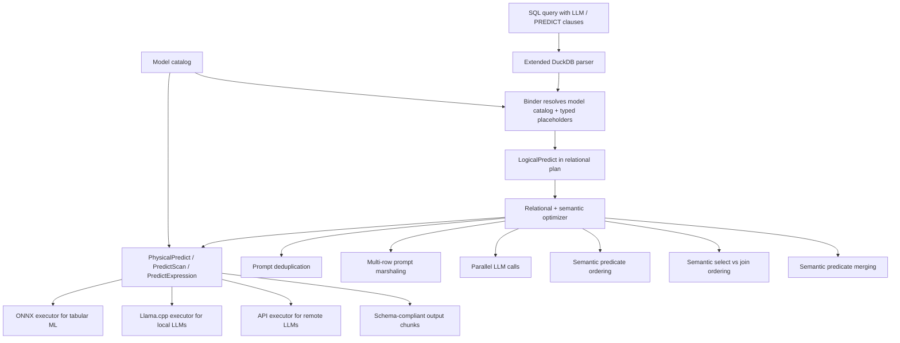

---

#### NousDB: a token-aware semantic query engine on DataFusion

[NousDB — A Fast Query Engine for Semantic Analytics](https://arxiv.org/abs/2610.28551) (Tsapelas, Koutrika, and Ioannidis, arXiv 2026) is an engine-level attempt to give semantic operations both **algebraic semantics** and efficient **token-priced** physical implementations. It extends Apache DataFusion/Arrow with three semantic relation-to-relation operators—**Extend** (add model-derived attributes), **semantic selection**, and **semantic join**—and distinguishes the singleton-invocation reference semantics from implementation-dependent batching.

- **Algebra and rewrites:** explicit, assumption-qualified semantics support two pushdowns and two operator-fusion rewrites. Fusing model calls is *not* automatically a semantics-preserving transformation: it depends on the composed prompt/model actually reproducing the reference function.
- **Costing:** equi-depth token-length histograms model the true amount of model work, not merely row cardinality; batch sizing accounts for instructions, expected output, context-window overflow risk, and token-length skew.
- **Fidelity-aware batching:** a query-time calibration uses one independent probe per batch and a Clopper–Pearson test to select batch sizes by agreement with singleton execution. This is **reference-output fidelity**, not a proof that singleton LLM outputs equal human ground truth; the paper reports at least 86% singleton agreement per tested query in certified runs.
- **Parallelism:** token-based repartitioning and load balancing aim to avoid stragglers caused by long rows. The prototype also pipelines multiple model requests.
- **Evidence:** the authors report up to **86×** speedup and **19×** lower token use against evaluated baselines on IMDB/SemBench, plus up to **35×** on JOB and Stack-derived multi-relation workloads. These are maximum observed improvements under the reported models and workloads, not universal factors.

**Positioning.** NousDB complements [CADENZA](https://arxiv.org/abs/2606.29151) (intent-specific task DAGs), [iPDB](https://arxiv.org/abs/2601.16432) (native DuckDB model integration), and [Kalypso](https://arxiv.org/abs/2607.23815) (LLM-serving scheduling). It highlights *physical equivalence to a model-backed oracle*, token statistics, and the danger of assuming that packing tuples into a prompt leaves semantics unchanged.

#### JEVDB: typed decision inference and semantic-join candidate reduction

[Prune First, Decide Fast: Scalable Semantic Query Processing with JEVDB](https://arxiv.org/abs/2610.02046) (Wang, Yan, Zhao, and Liu, arXiv 2026) makes a different architectural choice: many semantic predicates need a **Boolean probability, discrete choice, or ordinal score**, not unconstrained generated text. The engine uses the Jev decision-model primitives **Noul** (Boolean probability), **Choice** (categorical classification), and **Score** (ordered rubric score), passing typed results to conventional relational operators and escalating only difficult decisions to a generative LLM.

- **Three tiers:** relational predicate pushdown and candidate screening; parallel non-generative typed decisions; and calibrated LLM fallback for uncertain instances.
- **Joins:** combine exact Yannakakis-style semijoin reduction on *ordinary relational edges* with **Semantic Bloom Filters (SBFs)** on latent semantic join edges. An SBF may be a key set, bit vector, or pairwise screen based on a registered necessary condition; a reusable **condition index** amortizes document-level attribute scoring over query workloads.
- **Conditional correctness:** an SBF is lossless **only if** both the necessary condition and its attribute extractor are sound. If either is learned and merely validated empirically, pruning is approximate and can lose true matches. Separately, sampled calibration of the decision-model-to-LLM cascade controls an estimated precision/recall loss; it should not be equated with an unconditional end-to-end guarantee.
- **Execution:** anchor-sharing request layouts, asynchronous blockwise vectorized evaluation, pair memoization, and confidence thresholds — not just a different language model.
- **Evidence:** on 21 SemBench queries, JEVDB-Flash reports the lowest latency on all and lowest cost on 19, with quality matching or exceeding baselines on 18; on the new **Shelob** TPC-DS-derived semantic-join workload, it reports **87.4%** of candidates removed before inference and **95.7–97.5%** mean F1, for joins reaching **540,000** candidate pairs. Distinguish these reported, workload-specific outcomes from absolute dominance or a lossless guarantee for learned conditions.

**Positioning.** JEVDB links earlier [iPDB](https://arxiv.org/abs/2601.16432), [SemJoin](https://arxiv.org/abs/2606.29532), [FDJ](https://arxiv.org/abs/2512.05399), and [BaS](https://doi.org/10.1145/3802004) to a model/runtime co-design for *decision-heavy* SQL. It is particularly relevant when the logical query is stable but model inference and join fanout dominate cost.

### 2. Semantic relational and DataFrame operators

#### LOTUS: semantic operators for rich AI-based analytics

[LOTUS](https://arxiv.org/abs/2407.11418) is one of the central academic SQPE systems. It introduces semantic operators as a declarative programming interface extending the relational model with AI-based operations.

Operators include semantic filtering, sorting, joining, clustering, and aggregation. The system exposes these through a DataFrame API and develops optimizations for semantic filtering, clustering, and joins.

Key ideas:

- Composable semantic operators.
- Multiple physical implementations per semantic operator.
- Optimizer search space similar to relational operators.
- Acceleration techniques for semantic filter, cluster, and join operators.
- Statistical accuracy guarantees for some approximate execution strategies.
- Demonstrations on fact-checking, extreme multi-label classification, and search.

Why it matters:

LOTUS is probably the clearest articulation of semantic operators as a new relational-algebra-like layer. It provides a vocabulary for discussing SQPEs as database systems rather than as LLM applications.

#### Binder: binding language models in symbolic languages

[Binder](https://arxiv.org/abs/2210.02875) predates much of the SQPE wave but is important as an ancestor. It maps inputs to symbolic programs and binds language-model API calls into languages such as SQL and Python.

Key ideas:

- Neural-symbolic execution.
- LM calls embedded inside symbolic programs.
- SQL/Python programs that call LM functions for parts that symbolic languages cannot handle directly.
- Improved interpretability and debuggability compared with end-to-end neural answers.

Why it matters:

Binder foreshadows the SQPE pattern: keep the benefits of declarative/symbolic execution while using language models for semantic gaps.

---

### 3. Declarative AI dataflows and document processing

#### Palimpzest

[Palimpzest](https://arxiv.org/abs/2405.14696) is a declarative system for optimizing AI-powered analytical workloads over unstructured data.

Key ideas:

- Users specify AI-powered data-processing tasks declaratively.
- The system chooses among model, prompt, inference, hardware, and execution alternatives.
- Optimization considers runtime, monetary cost, and output quality.
- Evaluated on legal discovery, real estate search, and medical schema matching.

Why it matters:

Palimpzest expands the SQPE scope beyond SQL. It treats AI data processing as an optimizer problem over a large physical-plan space, including model choice and quality/cost tradeoffs.

#### DocETL

[DocETL](https://arxiv.org/abs/2410.12189) targets complex document-processing pipelines.

Key ideas:

- Declarative interface for document-processing pipelines.
- Agentic query rewriting to improve accuracy on complex LLM tasks.
- Logical rewrites tailored to LLM limitations, such as decomposing tasks or documents.
- Evaluation framework that synthesizes task-specific validation prompts.
- Optimization algorithm that searches over promising rewritten plans.

Why it matters:

DocETL emphasizes that the best plan is often not just the cheapest execution of the user's original operator. For difficult document tasks, the system may need to rewrite the task itself into a more reliable semantic plan.

#### EVAPORATE

[EVAPORATE](https://arxiv.org/abs/2304.09433) is adjacent but important. It uses language models to generate structured views over heterogeneous data lakes.

Key ideas:

- Convert unstructured/semi-structured documents into queryable tables.
- Compare direct extraction with code synthesis.
- Use weak supervision and ensembles of generated extraction functions.
- Reduce the number of tokens processed by the LLM through sublinear passes over documents.

Why it matters:

EVAPORATE is not an SQPE in the same direct sense as LOTUS or UQE, but it addresses a neighboring route: materialize semantic structure first, then query it using conventional systems.

---

### 4. Hybrid structured/unstructured query languages

#### SUQL

[SUQL](https://arxiv.org/abs/2311.09818) introduces Structured and Unstructured Query Language for conversational search over hybrid structured and unstructured data.

Key ideas:

- Extends SQL with free-text primitives such as `summary` and `answer`.
- Allows structured database access and unstructured information access to be composed in a precise notation.
- Uses LLM-based semantic parsing to map conversational input into SUQL.
- Demonstrates hybrid search over Yelp-style restaurant data.

Why it matters:

SUQL is important because many enterprise questions require both structured constraints and unstructured evidence. For example: "Find high-value customers whose last support call suggests they are likely to churn." That query is neither pure SQL nor pure RAG.

#### dIR and related hybrid retrieval/query systems

[dIR](https://arxiv.org/abs/2312.13264) and similar systems explore ways to expose unstructured and structured data through unified query interfaces. These systems are generally less DBMS-centric than SQPE systems but contribute to the broader design space for hybrid access.

---

### 5. Production cloud data platforms

#### Google BigQuery and AlloyDB AI queries

Google's SIGMOD 2026 paper, [100x Cost & Latency Reduction: Performance Analysis of AI Query Approximation using Lightweight Proxy Models](https://doi.org/10.1145/3802002), is a central production-oriented SQPE source. An arXiv version is also available as [arXiv:2603.15970](https://arxiv.org/abs/2603.15970).

The paper studies semantic operators such as:

- `AI.IF` for semantic filtering,
- `AI.RANK` for semantic ranking.

Key ideas:

- Avoid row-by-row LLM execution for high-volume semantic predicates.
- Train lightweight proxy models over embeddings.
- Use LLMs to label only a small sample.
- Evaluate the proxy against LLM labels.
- Use the proxy when quality is close enough, and fall back to the LLM otherwise.
- Support online proxy training for OLAP-style ad hoc BigQuery workloads.
- Support offline proxy training for low-latency AlloyDB-style HTAP workloads.
- Treat semantic filters and ranking as classification-like tasks when possible.

Why it matters:

This paper is one of the strongest arguments that production SQPEs need **semantic operator approximation**. It shifts the conversation from "How do we call an LLM from SQL?" to "How do we compile, approximate, and optimize AI operators at database scale?"

Public Google Cloud documentation also exposes related building blocks through [BigQuery ML](https://cloud.google.com/bigquery/docs/bqml-introduction), [remote models](https://cloud.google.com/bigquery/docs/bigquery-ml-remote-model-tutorial), [ML.GENERATE_TEXT](https://cloud.google.com/bigquery/docs/reference/standard-sql/bigqueryml-syntax-generate-text), [object tables](https://cloud.google.com/bigquery/docs/object-tables), and [vector search](https://cloud.google.com/bigquery/docs/vector-search).

#### Snowflake Cortex AISQL

[Snowflake Cortex AISQL](https://arxiv.org/abs/2511.07663) presents a production SQL engine for unstructured data.

Key ideas:

- Native semantic operations inside SQL.
- AI-aware query optimization that treats inference cost as a first-class optimization objective.
- Adaptive model cascades that route easy rows to cheaper models and uncertain rows to stronger models.
- Semantic join query rewriting that reduces quadratic semantic joins to multi-label classification-style problems.
- Production deployment informed by real Snowflake customer workloads.

Why it matters:

Snowflake Cortex AISQL is one of the strongest industrial confirmations that semantic SQL requires engine-level optimization rather than just scalar UDF wrappers.

Relevant product documentation includes [Snowflake Cortex](https://docs.snowflake.com/en/user-guide/snowflake-cortex), [Cortex LLM functions](https://docs.snowflake.com/en/user-guide/snowflake-cortex/llm-functions), and [Snowflake Cortex Search](https://docs.snowflake.com/en/user-guide/snowflake-cortex/cortex-search/cortex-search-overview).

#### Databricks Mosaic AI and SQL AI functions

Databricks exposes model calls inside SQL through functions such as [`ai_query`](https://docs.databricks.com/aws/en/sql/language-manual/functions/ai_query), along with Mosaic AI model serving and vector search capabilities.

Databricks is important in this landscape because it combines:

- SQL warehouse and lakehouse execution,
- model serving,
- vector search,
- Unity Catalog governance,
- MLflow and evaluation infrastructure,
- agent and Genie-style enterprise data interfaces.

From an SQPE perspective, Databricks is currently strongest as an AI-enabled lakehouse platform. The open research question is how far the platform moves from UDF-style AI calls toward optimizer-visible semantic operators with cost, quality, and provenance semantics.

---

### 6. LLM UDF and inference optimization inside relational workloads

#### Optimizing LLM Queries in Relational Workloads

[Optimizing LLM Queries in Relational Workloads](https://arxiv.org/abs/2403.05821) focuses on optimizing LLM invocations inside relational queries.

Key ideas:

- Analytical workloads increasingly invoke LLMs through SQL UDFs.
- Relational workloads create opportunities for KV-cache-aware row ordering.
- Column ordering can improve cache reuse.
- Deduplicating redundant requests can reduce inference cost.
- Implemented in Apache Spark with vLLM as the serving backend.

Why it matters:

This work is complementary to SQPEs with explicit semantic operators. Even if an engine starts with UDF-style calls, the relational structure of the workload can still be exploited to optimize LLM inference.

---

### 7. Query-aware LLM serving and execution layers

#### Kalypso: relational LLM serving

[Kalypso: Relational LLM Serving](https://arxiv.org/abs/2607.23815) introduces a new layer in the SQPE stack: **relational LLM serving**. Instead of treating the output of a semantic query optimizer as a flat stream of unrelated LLM requests, Kalypso lets an SQPE submit a semantic query plan to a serving layer that is aware of operator dependencies, pipeline stages, predicate behavior, and Cartesian-product structure.

Key ideas:

- Existing SQPEs usually invoke request-centric serving systems such as vLLM or SGLang, which optimize independent requests but do not know the semantic query plan.
- Many semantic query plans contain dependent operators over the same tuple, such as `sem_filter -> sem_map` or `sem_map -> sem_join -> sem_filter`.
- These dependent operators often share a long prompt prefix: system prompt plus serialized tuple context. Only the trailing task instruction changes.
- If the downstream operator runs before the tuple prefix is evicted from the KV cache, the serving engine can reuse the prefix rather than recomputing the prefill.
- Kalypso exposes an API in which semantic operators are registered as UDF-like implementations with execution contracts: whether they are pipelining or blocking, whether they are predicates, and whether they perform a Cartesian product.
- The system groups query plans into pipelines and stages, where a task is a stage execution on one tuple or tuple group.
- Its scheduler performs adaptive, memory-aware admission control: it balances upstream parallelism, downstream progress, GPU utilization, and KV-cache residency.
- It supports virtual pinning through scheduling discipline and can also use explicit KV-cache pinning when the underlying serving engine exposes it.
- It estimates output-token bounds online and includes retry, memory-estimation, and deadlock-recovery mechanisms.

The conceptual contribution is important because it separates three optimization layers that earlier SQPE discussions often conflate:

| Layer | Primary question | Examples |
|---|---|---|
| Semantic query optimizer | Which semantic plan should be executed? | LOTUS, Palimpzest, CADENZA, Horrila, Larch, DocETL |
| Semantic operator implementation | How should each semantic operator be implemented? | proxy models, cascades, FDJ, SemJoin, LLM `ORDER BY` access paths |
| Relational LLM serving | How should the remaining LLM requests be scheduled and cached? | Kalypso, vLLM/SGLang substrate, prompt/KV-cache reuse |

Kalypso is therefore not primarily another semantic operator language. It is a **serving substrate** for SQPEs. It complements call-reduction techniques such as proxy models, model cascades, vector prefilters, and semantic join rewrites by improving the execution of the LLM calls that remain.

In its evaluation, Kalypso reimplements semantic query workloads from LOTUS-style plans and compares against request-centric execution over vLLM. The workloads include FEVER fact verification, MEDEC medical error detection/correction, BioDEX biomedical reaction matching, and ContractNLI contract entailment. The reported speedups reach up to `4.57x`, with similar numbers of oracle LLM calls across systems; this means the gains mainly come from pipelining, prefix reuse, and memory-aware scheduling rather than from changing query semantics or reducing accuracy.


#### FFX: factorized and vectorized execution for semantic queries

[Factorized and Vectorized Execution: Optimizing Analytical and Semantic Queries over Relations](https://arxiv.org/abs/2609.09002) introduces **FFX**, a fast factorized execution engine for join-heavy analytical queries. Its core contribution is not a new LLM operator, but a new execution substrate for relational intermediates that may later feed semantic operators.

Key ideas:

- Many SQPE workloads contain join-heavy relational subplans before semantic processing.
- If those subplans are fully materialized as flat tuples, intermediate size can explode, and semantic operators inherit the explosion as prompt tokens.
- FFX combines arbitrary factorization schemes with vectorized, cache-friendly execution through **packed factorized vectors**.
- For semantic processing, FFX adapts Flock-style LLM operators to consume serialized factorized vectors rather than only flattened tuples.
- In its keyword-generation experiment over citation-chain triples, factorized semantic processing reduces input tokens by up to about `22.5x` relative to a flat representation at comparable task structure; quality/latency trade-offs vary with batch size.

Why it matters:

FFX adds a missing execution-level idea to SQPEs: sometimes the best way to reduce semantic-operator cost is not to replace the model, but to preserve compact relational structure until the moment it is serialized for the model. This is especially relevant for semantic operators downstream of many-to-many joins, graph/path queries, recommendation workloads, and agent-context construction.

Conceptually, FFX complements Kalypso:

| Layer | Main optimization | Representative system |
|---|---|---|
| Relational intermediate representation | Avoid flattening join-heavy subplans before semantic operators | FFX |
| LLM serving and KV-cache scheduling | Avoid recomputing shared prefixes after semantic plans are formed | Kalypso |
| Operator access path | Reduce or approximate expensive semantic invocations | LOTUS, UQE, FDJ, SemJoin, Larch |

#### Related serving and runtime work

Kalypso makes several LLM-serving papers relevant to SQPEs, even though most of them are not themselves query engines:

| Work | Relevance to SQPEs |
|---|---|
| [vLLM / PagedAttention](https://arxiv.org/abs/2309.06180) | Efficient KV-cache memory management for LLM serving; Kalypso builds on vLLM-style serving and uses its prefix-cache capabilities as the substrate. |
| [SGLang](https://arxiv.org/abs/2312.07104) | Structured LLM program runtime with RadixAttention-style prefix reuse; relevant for semantic programs and repeated prompt-prefix sharing. |
| [Orca](https://www.usenix.org/conference/osdi22/presentation/yu) | Iteration-level scheduling and selective batching for generative model serving; a foundational request-centric serving baseline. |
| [Sarathi-Serve](https://www.usenix.org/conference/osdi24/presentation/agrawal) | Chunked prefill and throughput/latency trade-off management; relevant to prefill-heavy semantic operators. |
| [DistServe](https://www.usenix.org/conference/osdi24/presentation/zhong-yinmin) | Disaggregates prefill and decode; useful context for serving architectures where SQPE workloads have large tuple-context prefills. |
| [Llumnix](https://www.usenix.org/conference/osdi24/presentation/sun-biao) | Dynamic scheduling and migration across LLM instances; adjacent to workload-aware serving and isolation. |
| [Prompt Cache](https://proceedings.mlsys.org/paper_files/paper/2024/hash/42a9f67b9afc73c7c9a128e5a0d1e4e4-Abstract-Conference.html) | Modular attention reuse for stable prompt components; conceptually related to Kalypso's cross-operator prefix reuse. |
| [Continuous Prompts](https://arxiv.org/abs/2512.03389) | LLM-augmented stream-processing framework; relevant as an adjacent runtime that brings semantic operators into streaming pipelines. |
| [SemPipes](https://arxiv.org/abs/2602.05134) | Semantic data operators for tabular ML pipelines; relevant because it treats semantic operators as optimizable components inside data-processing pipelines rather than only interactive analytics queries. |
| [Task Cascades](https://arxiv.org/abs/2601.05536) | Extends model cascades to task-level decompositions for unstructured data processing; complementary to serving-level optimizations because it reduces or redirects work before serving. |
| [Deep Research is the New Analytics System](https://arxiv.org/abs/2509.02751) | Argues for analytics runtimes that combine semantic operators with dynamic deep-research-style execution; useful for positioning SQPEs as part of a broader AI-driven analytics runtime. |

---

#### SemBaker: compiling semantic operators into local functions

[From Interpretation to Compilation: A Compilation-Based Execution Engine for Semantic Operator Systems](https://arxiv.org/abs/2608.06677) (Dong and Wang, arXiv 2026) introduces **SemBaker**, an external plugin for Palimpzest, LOTUS, Nirvana, and DocETL. Instead of paying an LLM for each filter/map row or join pair, it may call an LLM *once* to synthesize a deterministic Python `compiled_filter`, `compiled_map`, or `compiled_join` and then execute the function locally. Its cost-based router chooses native-versus-compiled execution according to operator cardinality, compilation overhead, and a heuristic test of whether the predicate can reasonably be expressed as code; compilation can overlap upstream pipeline execution.

The authors report **4.8–6.3×** mean speedups and **5.4–10.7×** mean cost reductions on their evaluation settings with competitive reported quality. The key limitation is semantic scope: compilation is excellent for codifiable predicates (existing structured features, explicit rules) but cannot in general reproduce open-ended world knowledge, subtle reasoning, or subjective LLM judgments. Rewriting a model predicate as executable code is therefore a **candidate approximate implementation**, not a semantics-preserving equivalence by default. Its runtime is complementary to NousDB's token-priced batching and JEVDB's non-generative model substitution.

### 8. Benchmarks

#### SemBench

[SemBench](https://arxiv.org/abs/2511.01716) is the most important benchmark for SQPEs so far.

Key characteristics:

- Explicitly targets semantic query processing engines.
- Covers multiple scenarios, including movie reviews and medical question answering.
- Covers multiple modalities, including text, image, and audio.
- Covers multiple operators, including semantic filters, joins, mappings, ranking, and classification.
- Evaluates academic systems such as LOTUS, Palimpzest, and ThalamusDB, plus an industrial system, Google BigQuery.

Why it matters:

SemBench provides a common benchmark vocabulary for a fragmented ecosystem. It also makes clear that SQPE evaluation must consider more than final answer accuracy. It must also consider cost, latency, robustness, modality, operator coverage, and execution strategy.

#### LROBench

[LROBench](https://arxiv.org/abs/2603.02537) complements SemBench by shifting the evaluation lens from broad semantic-query systems to **LLM-enhanced relational operators (LROs)**. An LRO is a logical extension of SQL that takes relational input, a natural-language requirement, and an operand granularity such as cell, row, column, or table, invokes an LLM, and materializes the result as a relation.

Key characteristics:

- It introduces a unified taxonomy of five LRO intents: **Filter**, **Match**, **Impute**, **Cluster**, and **Order**.
- It distinguishes operand granularity: cell, row, column, table.
- It distinguishes implementation variants such as `LLM-ALL`, `LLM-ONE`, `LLM-SEMI`, `LLM-PAIR`, `LLM-SORT`, and `LLM-SCORE`.
- It contains **350 query instances** over **27 real-world relational databases**: **290 single-LRO queries** and **60 multi-LRO queries**.
- It explicitly separates single-operator evaluation from multi-operator system evaluation, which SemBench largely leaves implicit.
- Its query instances are represented as natural-language question, procedural plan, and human-verified relational result triples.
- The benchmark data and evaluation code are available at [github.com/LROBench/LROBench](https://github.com/LROBench/LROBench/).

Why it matters:

LROBench is important because it makes the **operator design problem** explicit. It shows that the same logical LRO may have very different behavior depending on whether the engine batches all candidates into one prompt, asks the LLM one tuple at a time, uses semi-join-style prompting, uses pairwise comparisons, or asks for scalar scores. This is directly relevant to SQPE physical planning: the benchmark turns semantic operators into access-path families rather than single black-box functions.

Empirical design takeaways:

- Row-wise Filter: `LLM-ONE` is a strong default; `LLM-ALL` can be more cost-efficient and competitive for strong long-context models.
- Column/table Filter: `LLM-ALL` is preferred because it gives the model a global view of candidates.
- Match: `LLM-ALL` generally performs best for cell-, row-, and column-level matching, while `LLM-SEMI` is competitive for some row-wise matching tasks.
- Impute: column generation benefits from `LLM-ONE`; cell/row imputation benefits from the richer context of `LLM-ALL`.
- Cluster and Order: `LLM-ALL` is preferred because global context reduces criterion drift and inconsistent pairwise judgments.
- Scale breaks naive batching: `LLM-ALL` is cost-attractive but has an effective-context-window failure mode, even when the nominal context window has not been exceeded.

A simplified LRO taxonomy is:

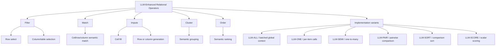

LROBench also sharpens the relationship among several strands of work that should be kept in scope for SQPE surveys: schema linking as column/table filtering, entity matching as row/cell matching, table imputation and column generation as imputation, semantic clustering as group-by-like clustering, and semantic `ORDER BY` as ranking.

#### Spider 2.0-AIFunc

[Spider 2.0-AIFunc](https://arxiv.org/abs/2607.06229) extends enterprise text-to-SQL evaluation into **AI-native SQL workflows**. It is not an SQPE runtime benchmark in the same sense as SemBench or LROBench. Instead, it evaluates the **front-end synthesis problem**: can a model or agent generate a correct SQL query that composes ordinary relational operators with SQL-callable AI functions exposed by a production cloud data platform?

Key characteristics:

- It contains **465 verified instances** across **125 real-world Snowflake databases**.
- It is built from Spider2-Snow tasks by rewriting conventional enterprise SQL tasks into AI-native SQL tasks.
- It covers six Snowflake Cortex AI function types: `AI_CLASSIFY`, `AI_FILTER`, `AI_SENTIMENT`, `AI_SIMILARITY`, `AI_EXTRACT`, and `AI_AGG`.
- Most tasks combine AI functions with conventional SQL logic rather than placing an AI call in isolation: the gold queries average **65 lines**, reference an average of **3.9 tables**, and often include joins, CTEs, aggregations, and nested query logic.
- The benchmark construction pipeline uses agents to rewrite both the target SQL and the natural-language instruction, explicitly specifying AI function usage and parameters such as classification labels and extraction schemas.
- The verification protocol addresses the non-determinism of model-backed SQL functions by repeatedly executing the gold SQL across multiple passes and time windows; released instances must produce stable results.
- Evaluation executes both the gold and predicted SQL in the same time window, rather than comparing against a stale stored result, because the underlying AI functions may change or exhibit small output variation.

Why it matters:

Spider 2.0-AIFunc captures a layer that SQPE benchmarks had not isolated: **AI-native SQL generation**. SemBench asks whether an engine can execute semantic queries well. LROBench asks which operator implementation/access path works best for relation-native LLM-enhanced operators. Spider 2.0-AIFunc asks whether an NL-to-SQL model can correctly synthesize the query in the first place, including choosing the right AI function, grounding it to the right schema columns, supplying parameters, and integrating the function call with surrounding relational logic.

Empirical takeaways:

- Strong proprietary models reach roughly **67-70% execution accuracy**, while the strongest open-source model reported reaches **58.1%**.
- Most systems can produce executable SQL, so failures are less about syntax and more about semantic correctness.
- Common failure modes include schema grounding, missing or incorrect predicates, incorrect aggregation/join/query logic, and AI-function misuse or missing parameters.
- Traditional text-to-SQL agent frameworks focused on schema retrieval and table selection do not clearly outperform a minimal Spider-Agent setup once AI-function documentation is supplied. This suggests that AI-native SQL requires new agent scaffolds focused on function semantics, parameterization, determinism, and placement of AI calls in the relational plan.

A simplified view of how Spider 2.0-AIFunc complements SemBench and LROBench is:

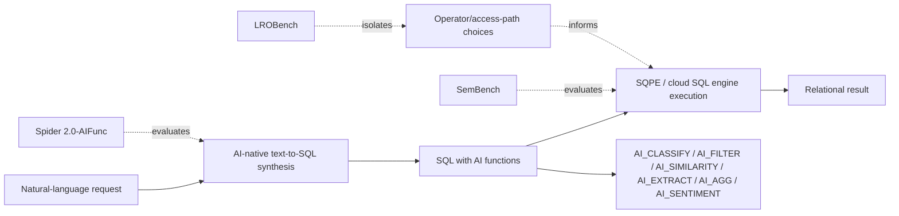


#### UDA-Bench: relational answers over extracted unstructured data

[Unstructured Data Analysis using LLMs: A Comprehensive Benchmark](https://arxiv.org/abs/2510.27119) (Deng et al.; reported as PVLDB 2026 in subsequent literature) evaluates unstructured-document analytics against manually annotated **relational views** and query workloads. The benchmark decomposes performance into extraction of relational attributes from documents, evaluation of classical relational operators on those attributes, and end-to-end query correctness. This bridges SemBench's heterogeneous semantic-operator scenarios, LROBench's relation-native operator variants, and the **uncertainty-propagation** problems studied below. Its repository is available at [UDA-Bench](https://github.com/Chandrika2527/UDA-Bench).

#### Same Query, Different Answer: run-to-run variance in SQPE execution

[Same Query, Different Answer: Run-to-Run Variance in Semantic Query Processing](https://arxiv.org/abs/2610.13823) (Hassanzadeh and Subramanian, arXiv 2026) reruns **SemBench, LROBench, and UDA-Bench** through their respective benchmark harnesses, reanalyzes published SemBench results, and records roughly **1.2 million model calls**. It measures the same query under repeated executions at **temperature 0** and distinguishes changes in individual semantic-operator outputs, final relational answers, and final benchmark quality scores.

The authors report **0.07%–10.2%** varying per-item outputs across model settings (and up to **24%** on a particular task). Small disagreement rates are amplified by plans returning many rows or join pairs: a possible-worlds model predicts that whole-answer reproducibility often decays roughly exponentially with the number of independently exposed judgments. On one UDA-Bench setting, around **two-thirds of answers change** although only a few percent of extracted values do. The study also finds that **16 of 28** repeated tests of LROBench implementation recommendations were statistically unresolved; this is a warning against inferring stable algorithm rankings from one trajectory.

**Practical implications:** report a deployment (model weights **and serving stack**), repeated per-row/pair disagreement, answer reproducibility, run-to-run quality distributions and confidence intervals, and cost/latency distributions; separate oracle-reference instability from algorithmic approximation. Voting helps but does not guarantee identical whole-query answers, and a cascade's probabilistic precision/recall guarantee does not imply a deterministic result. These results are complementary to [The Stochastic Shift](https://arxiv.org/abs/2609.21133): the latter evaluates **semantic equivalence of generated AI SQL**, whereas this work evaluates **repeated execution of a fixed AI-backed query plan**.

#### The Stochastic Shift: evaluating AI-operator SQL beyond strict execution equality

[The Stochastic Shift](https://arxiv.org/abs/2609.21133) addresses a problem that becomes unavoidable once benchmarks include AI operators: a query can be semantically correct even if it does not produce the exact same rows or counts as the reference query, because prompt phrasing and model nondeterminism can shift borderline AI decisions.

Key ideas:

- Traditional execution accuracy assumes deterministic SQL and exact result equality.
- AI operators such as `AI.IF`/`NLfilter` can make valid semantic judgments that differ slightly across prompts or executions.
- The paper proposes a **Multilayered Evaluation Framework** that splits a query into deterministic relational structure and AI-semantic components, executes the full and split components, and then uses an autorater to evaluate relational and AI correctness separately.
- The evaluation uses SemBench queries over BigQuery and ThalamusDB.
- The reported results show strict execution accuracy has very low true-positive rates on AI-operator SQL, while the multilayered method achieves substantially higher overall accuracy on both systems.

Why it matters:

Spider 2.0-AIFunc focuses on generating AI-native SQL, while The Stochastic Shift focuses on evaluating it. Together they show that AI-native SQL benchmarking needs two layers: generation benchmarks that require correct function selection and parameterization, and evaluation protocols that avoid treating every stochastic semantic boundary difference as a failure.

#### HybridDeepResearch: SQL plus web search as an adjacent benchmark frontier

[HybridDeepResearch](https://arxiv.org/abs/2609.09410) is not an SQPE benchmark in the narrow operator-execution sense, but it is relevant to the broader trajectory of AI-native analytics. It evaluates agents that must combine SQL database querying with web search to answer a single verifiable question.

Key characteristics:

- It contains **380** tool-dependent tasks grounded in LiveSQLBench-Base-Lite databases and public web corpora.
- It defines three reasoning patterns: **SQL2S** (SQL result constrains search), **S2SQL** (search result constrains SQL), and **Parallel** (SQL and search independently produce candidate sets whose intersection yields the answer).
- It includes a balanced hard subset of **120** examples.
- Even strong models are reported to reach only roughly `50-54%` Pass@8 on the hard subset.

Why it matters:

HybridDeepResearch points to a boundary condition for SQPEs: many real analytical tasks will not live entirely inside a database or entirely on the open web. Future SQPEs and AI-native analytics systems may need to preserve constraints across SQL, semantic operators, external search, and agentic evidence synthesis. This is adjacent to SQPEs rather than a replacement for SemBench/LROBench/Spider 2.0-AIFunc.

---

### 9. Meta-engines and system-of-systems approaches

#### Meta Engine

[Meta Engine](https://arxiv.org/abs/2602.01701) proposes a unified semantic query engine over heterogeneous LLM-based query systems.

Key ideas:

- A semantic query ecosystem may remain fragmented.
- Different systems specialize in different modalities, operators, or data types.
- Meta Engine parses natural-language queries, generates operators, routes subqueries to adapters, and aggregates results.

Why it matters:

Meta Engine suggests a future in which the SQPE is not one monolithic engine but a coordinator over specialized semantic engines, vector databases, SQL systems, and multimodal processors.

#### DASE: evidence linking and semantic prefiltering for multi-step reasoning

[Efficiently Linking Unstructured Data for Multi-step Reasoning](https://arxiv.org/abs/2609.19491) introduces **DASE**, a query engine for the evidence-linking layer of agentic data workflows. It is not a full SQPE in the LOTUS/BigQuery sense, but it is highly relevant to SQPE execution because it constructs ranked candidate evidence tuples using structured predicates, exact joins, multiple vector scores, and thresholded embedding-similarity joins before downstream LLM reasoning.

Key ideas:

- Agentic data workflows often need to retrieve and link evidence fragments before invoking more expensive semantic operators or reasoning agents.
- DASE formalizes top-k multi-step reasoning queries as a combination of predicates, similarity-join conditions, and a monotone scoring function.
- It introduces **SemJI**, a sparse materialized embedding-similarity join index for rare near-neighbor pairs.
- Its execution layer combines predicate-aware ANN traversal, batched access, filtered score streams, and threshold-based aggregation.
- DASE can either answer a ranked evidence-retrieval query directly or act as a high-recall prefilter for later semantic-operator post-processing.

Why it matters:

DASE suggests a new SQPE-adjacent substrate: before an engine invokes LLM filters, semantic joins, or answer-synthesis agents, it may benefit from a relational/vector prefilter that preserves joins and provenance while keeping recall high. The reported SemBench E-Commerce example is particularly relevant: DASE used as a prefilter improves BigQuery quality from `0.67` to `0.80` while reducing cost from `$2.42` to `$0.54`.

This positions DASE as a bridge between vector databases and SQPEs:

| Traditional vector DB | DASE-style evidence engine | Full SQPE |
|---|---|---|
| Top-k over one vector space plus filters | Multi-table, multi-vector, thresholded similarity joins with ranked evidence tuples | Declarative semantic operators with LLM-backed filters, joins, maps, ranks, and aggregation |
| Retrieval-centric | Retrieval + relational linking | Query semantics + model-backed execution |
| Usually not optimizer-visible as semantic operator plans | Can feed candidate sets to SQPE semantic operators | Executes semantic operators directly |

---


## Operator-specific SQPE optimization and access paths

More recent work sharpens the distinction between **semantic operators as logical abstractions** and **semantic operators as families of physical access paths**. This is the same architectural move that made relational databases powerful: `JOIN`, `ORDER BY`, and `WHERE` are not single algorithms; they are logical operators with many possible physical implementations. The SQPE frontier is now applying the same idea to LLM-backed filters, joins, ranks, maps, and task pipelines.

### LROBench: operator-level taxonomy and access-path variants

[LROBench](https://arxiv.org/abs/2603.02537) provides a useful operator-level lens for the rest of this section. It argues that many systems expose conceptually similar LLM-enhanced relational operators under different names, and that the important distinction is not just the operator name but also the **operand granularity** and **physical implementation pattern**.

For SQPE design, this suggests three levels of abstraction:

1. **Logical intent**: Filter, Match, Impute, Cluster, Order.
2. **Operand granularity**: cell, row, column, or table.
3. **Physical access path**: batched global prompting, per-item prompting, semi-join prompting, pairwise comparison, comparison sorting, or scalar scoring.

This is an important refinement to the SQPE taxonomy. For example, a semantic join may be a Match operator, but its implementation can be nested-loop pairwise prompting, semi-join-style prompting, all-candidates prompting, embedding cascade, classifier join, cluster join, featurized decomposition, or approximate join sampling. Likewise, semantic ordering can be pointwise scoring, pairwise sorting, listwise ordering, external merge sort, or budget-aware access-path selection.

### CADENZA: task-specific operator DAGs and TxRA

[CADENZA](https://arxiv.org/abs/2606.29151) is a major SQPE optimizer paper because it argues that a semantic operator instance should not be treated as an opaque function call. Instead, it should be decomposed into an **intent-specific DAG of typed task operators**.

Key ideas:

- A semantic operator template such as `SemFilter` is distinct from a semantic operator instance, which binds that template to a concrete natural-language intent and inputs.
- CADENZA introduces **task-extended relational algebra (TxRA)**, a conservative extension of relational algebra with task-specific operators such as OCR, VQA, TextQA, classification, entailment, and embedding.
- Intermediate task outputs become relational attributes. This lets the optimizer filter, reorder, threshold, route, and tune them.
- The logical planner synthesizes seed task DAGs, applies dependency-checked structural rewrites, and enumerates semantic alternatives such as `VQA(Image, q)` versus `OCR(Image) -> TxtQA(Text, q)`.
- The physical planner compiles each task operator into a router over heterogeneous backends: symbolic rules, specialized models, general-purpose LLMs, and composite pipelines.
- Routing cutpoints, backend parameters, and relational thresholds are jointly tuned with Bayesian optimization.

Why it matters:

CADENZA generalizes the SQPE optimizer beyond choosing among a few monolithic physical operators. It suggests that the right unit of optimization is the **sub-task inside a semantic operator instance**. This makes it a bridge between relational optimization, Palimpzest-style AI workload optimization, DocETL-style rewrite search, and production AI SQL.

A representative CADENZA-style decomposition is:

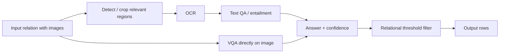

### Larch: learned runtime ordering of semantic predicates

[Larch](https://arxiv.org/abs/2606.07923) focuses on an increasingly common production pattern: a SQL query has multiple `AI_FILTER` predicates in a Boolean expression. The order of evaluation matters because short-circuiting can avoid expensive LLM calls, but the selectivity and correlation of semantic predicates are row-dependent and not known from traditional histograms.

Key ideas:

- Semantic filter ordering is modeled as a runtime adaptive optimization problem.
- `Larch-A2C` encodes an arbitrary semantic filter expression tree using document/predicate embeddings and a Gated Graph Neural Network, then learns an Advantage Actor-Critic policy over evaluation order.
- `Larch-Sel` decomposes the problem into per-row/per-filter selectivity prediction and exact dynamic-programming order selection.
- Larch exploits the fact that LLM calls are slow enough that local model updates can be overlapped with remote inference latency.
- The paper positions Larch against Palimpzest-style and Quest-style baselines and reports large token-overhead reductions.

Why it matters:

Larch makes **semantic selectivity estimation** concrete. Traditional selectivity estimates are relation-level statistics; Larch learns instance-specific pass probabilities from embeddings and execution feedback. This is a direct analog of adaptive query processing for the AI SQL era.

### Fast LLM-Based Semantic Filtering: unifying CSV, BARGAIN, and ScaleDoc

[Fast LLM-Based Semantic Filtering](https://arxiv.org/abs/2606.08090) is a focused physical-operator paper for yes/no semantic predicates over document corpora under a corpus-level target accuracy.

Key ideas:

- It unifies three cascade families under a single six-step template: partition, sample, label, build proxy, calibrate, deploy.
- The three families are:
  - **CSV / model-free clustering**: cluster documents, label a few examples per cluster, and propagate labels.
  - **BARGAIN / prebuilt small-LLM proxy**: use a smaller LLM as a proxy and cascade uncertain cases to the oracle.
  - **ScaleDoc / online-trained proxy**: train a per-query proxy over oracle-labeled examples.
- The paper adds an adaptive two-phase method: try model-free clustering first, then escalate to an online proxy only when needed.
- It uses the oracle LLM's per-document confidence as a soft label, a query difficulty score, and a lower-bound diagnostic for the minimum possible cascade calls.
- It replaces simple cosine bi-encoder representations with token-aware and richer query-document representations such as cross-encoder / ColBERT-style signals.

Why it matters:

This paper is important because it decomposes semantic filtering into reusable physical design knobs rather than treating each published method as a separate algorithm. It also shows that **difficulty-aware operator selection** belongs inside the SQPE optimizer.

### Certified semantic views and cross-query oracle-label reuse

A semantic filter result is not merely a transient Boolean mask: it is a potentially reusable **materialized semantic view** of the oracle's decisions. But predicate-text similarity and natural-language entailment do not reliably imply label agreement, especially under stochastic model execution. [SemWeave: Semantic Common Expressions for LLM-powered Query Processing](https://doi.org/10.1145/3788853.3801593) explores reuse by matching previous semantic predicates and inferred entailment relations. It is an instructive optimization but its reused decisions are not intrinsically certified against the current predicate.

[Semantic Views: Certified Reuse of LLM Labels Across Semantic Queries](https://arxiv.org/abs/2610.12768) (Hassanzadeh and Subramanian, arXiv 2026) develops **SemViews**, implemented as an optimizer around LOTUS, to reuse prior paid labels **without relying on them as a correctness premise**:

1. Materialize labels with provenance for predicate, input columns, oracle/model version, and known/derived/unknown values; views may be partial.
2. Use related views, local row embeddings, and a lightweight helper score *only as features* to order tuples, trained using a fresh shaping sample; refine the most uncertain region with labels required by the query anyway.
3. Partition the ordered tuples into likely reject, oracle-evaluate, and likely accept regions. Freeze the regions **before** independent stratified certification samples.
4. Use exact finite-population hypergeometric bounds and deterministic gap-closing to certify both user-specified **precision and recall**, with joint failure probability at most `delta`. If evidence is insufficient, pay for more oracle labels rather than trusting a cached answer.

The paper evaluates four recorded workloads totaling **725,000** oracle labels, replayed in **145,000** queries: **99.63%** of replayed queries met both targets (for the evaluated `delta=0.05` setup), with **28–45%** fewer oracle calls than exact evaluation. Reworded repeats saved a further **27–36%** under the study's settings. These empirical percentages should be read with the formal guarantee's scope: user-specified precision/recall are measured **relative to the configured oracle's reference labels**, not independently verified human truth; the benchmark replays recorded decisions, not live stochastic calls. The guarantee applies to semantic filtering over text, **not** semantic joins, ranking, or arbitrary multioperator plans.

This brings together query-result caching, materialized-view maintenance, statistical AQP, and per-query cascades. It exposes a new access path for SQPE optimizers: **cross-query reuse as a ranking/prior signal plus certified fresh evaluation**, rather than direct semantic-cache substitution. It is complementary to [BARGAIN](https://arxiv.org/abs/2509.02896), embedding proxies, and [JEVDB](https://arxiv.org/abs/2610.02046)'s reusable condition index; the last is a reusable *attribute/decision index*, not the same as a certified reuse of previous predicate labels.

### Semantic joins: FDJ, SemJoin, ABJ, and BaS

Semantic joins are becoming the most active operator-specific subfield in SQPEs. The naive physical implementation requires `O(M x N)` model calls, so almost every paper proposes a different way to reduce or approximate the cross product.

#### Featurized-Decomposition Join (FDJ)

[Featurized-Decomposition Join](https://arxiv.org/abs/2512.05399) argues that raw embedding similarity often fails for semantic joins because long records contain multiple relevant and irrelevant facts. A single vector may not preserve the exact features needed by the join predicate.

Key ideas:

- Use LLMs to extract candidate features from records.
- Construct a **featurized decomposition**: a CNF logical expression over inexpensive feature-distance predicates.
- Use labeled samples to choose thresholds and provide statistical precision/recall guarantees.
- Reduce quadratic pairwise LLM comparisons by paying a linear or near-linear feature extraction cost plus cheap predicate evaluation.

This makes FDJ an important complement to LOTUS-style embedding cascades. It shifts the proxy from a scalar similarity score to a structured logical approximation of the semantic predicate.

#### SemJoin

[SemJoin](https://arxiv.org/abs/2606.29532) takes a strategy-routing view. Instead of assuming one semantic join algorithm is always best, it uses an LLM advisor over the join predicate, schema, and samples to route each join to one of two strategies:

- **Classifier strategy**: for predicates that reduce to a shared discrete label set, classify both tables and perform an equi-join on the labels.
- **Cluster Join**: for more general predicates, cluster embeddings, filter cluster pairs with samples, and run batched LLM matching only on surviving cluster pairs.

Why it matters:

SemJoin makes a strong case that semantic joins need **access-path selection**, not just a faster default implementation. Its classifier strategy also connects directly to the Snowflake Cortex AISQL insight that some semantic joins can be reformulated as classification.

#### Adaptive Block Join (ABJ)

[Implementing Semantic Join Operators Efficiently](https://arxiv.org/abs/2510.08489) is the ABJ line of work cited by SemJoin and BaS. It focuses on prompt-level physical execution: pack blocks of tuples from both relations into a single LLM prompt and adapt the block size to avoid context overflow as selectivity changes.

Why it matters:

ABJ optimizes the **cost of checking candidate pairs**. FDJ, SemJoin, and BaS focus more on reducing or selecting candidate pairs. These approaches are complementary.

#### Blocking-augmented Sampling (BaS)

[Accelerating Approximate Analytical Join Queries over Unstructured Data with Statistical Guarantees](https://doi.org/10.1145/3802004) targets analytical aggregate queries over semantic joins, not necessarily materialized exact join outputs.

Key ideas:

- Embedding-based blocking is efficient but biased because false negatives can be silently removed.
- Uniform sampling has statistical guarantees but is inefficient because positive pairs are often sparse.
- **Weighted Wander Join (WWJ)** uses embeddings as an approximate importance-sampling index.
- **Blocking-augmented Sampling (BaS)** divides the cross product into a high-similarity blocking regime and a lower-similarity sampling regime, allocating oracle budget adaptively.
- The result is an approximate semantic analytical join with confidence intervals.

Why it matters:

BaS connects SQPEs back to classical approximate query processing. It is especially relevant for semantic `COUNT`, `AVG`, and join-cardinality estimation, including optimizer support for multi-way semantic join ordering.

A join-oriented SQPE optimizer now needs to choose among at least four axes:

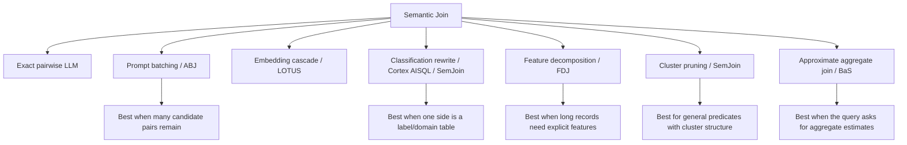

### Semantic ORDER BY / AI_RANK access paths

[Access Paths for Efficient Ordering with Large Language Models](https://arxiv.org/abs/2509.00303) treats `LLM ORDER BY` as a logical semantic operator and studies alternative physical implementations.

Key ideas:

- Pointwise: independently score each row and sort by the score.
- Pairwise: compare row pairs and use comparison-sort-style algorithms.
- Listwise: ask the model to rank a set of candidates at once.
- External and budget-aware variants: adapt classical external sorting ideas to LLM-based ranking.
- LLM-as-judge and consensus aggregation are used to select access paths under a budget.
- No single method is universally optimal; factual tasks and reasoning-heavy tasks favor different access paths.

Why it matters:

This paper is the semantic-ranking analog of join access-path selection. It argues that a semantic rank/sort operator cannot be implemented by one fixed strategy. It needs an optimizer that reasons about task type, model, budget, and expected quality.

#### ListK: listwise semantic `ORDER BY ... LIMIT K`

[ListK: Semantic ORDER BY and LIMIT K with Listwise Prompting](https://arxiv.org/abs/2603.17223) is a focused semantic top-k system for the `ORDER BY <natural-language criterion> LIMIT K` operator. It complements the broader LLM `ORDER BY` access-path study by going deeper on one family of physical implementations: listwise ranker calls plus rank-aggregation algorithms.

Key ideas:

- Treat semantic top-k and semantic full sort as one operator family: return the best `K` rows or a complete ranking under a natural-language ordering criterion.
- Replace pairwise comparisons with **listwise ranker calls**, where a specialized ranking model orders a small list of candidates at once.
- Study four physical algorithms: deterministic **LTTopK**, Las Vegas **LMPQSelect**, Las Vegas **LMPQSort**, and Monte Carlo **LTFilter**.
- Provide cost models and parameter choices so a query optimizer can select an execution plan under a target recall/quality objective.
- Show that listwise execution can dominate pairwise and pointwise baselines on the latency-quality frontier, with LTFilter useful as a lossy but efficient prefilter when `K` is small.

Why it matters:

ListK makes semantic ranking look like a real DBMS operator family rather than a single call pattern. It also clarifies a useful division of labor: a specialized listwise ranker is the physical ranking kernel, while the SQPE optimizer chooses a tournament, quickselect, quicksort, or filter-plus-rank aggregation strategy depending on `N`, `K`, list size, target recall, and latency budget.

#### Opaque top-k as an adjacent foundation

[Approximating Opaque Top-k Queries](https://arxiv.org/abs/2503.20119) is not framed as a semantic-operator system, but it is highly relevant to SQPE ranking because it studies top-k queries where the scoring function is an expensive black-box UDF. In many SQPE settings, that scoring function may be an LLM, a reward model, a vision-language model, or a domain-specific ML model.

Key ideas:

- Build a task-independent hierarchical index by clustering records using a cheap representation.
- Treat query execution as an anytime bandit problem over clusters, where each oracle call evaluates one record with the opaque scoring function.
- Use histogram sketches to estimate each cluster's score distribution and prioritize clusters with high expected marginal gain for the current top-k set, especially fat-tailed clusters that may contain rare high scorers.
- Provide approximation guarantees for the discrete non-negative-score setting and practical histogram maintenance for continuous or unknown score domains.
- Evaluate on synthetic, tabular-regression, and image workloads, showing that adaptive cluster-aware search can reach near-optimal top-k utility substantially faster than exhaustive scan or naive sampling.

Why it matters:

Opaque top-k provides a database/AQP lens for semantic ranking when the model returns scores rather than direct comparisons. It is especially relevant for `ORDER BY reward_model_score LIMIT K`, query-centric AI workflows, and AI-function SQL systems where the model-backed ordering function is available only through calls, not through a transparent algebraic expression. It is adjacent rather than a full SQPE because it optimizes black-box pointwise scoring, whereas ListK and LLM `ORDER BY` access-path work optimize natural-language semantic ordering operators more directly.

Together, these ranking papers suggest that an SQPE should support at least three rank/sort families:

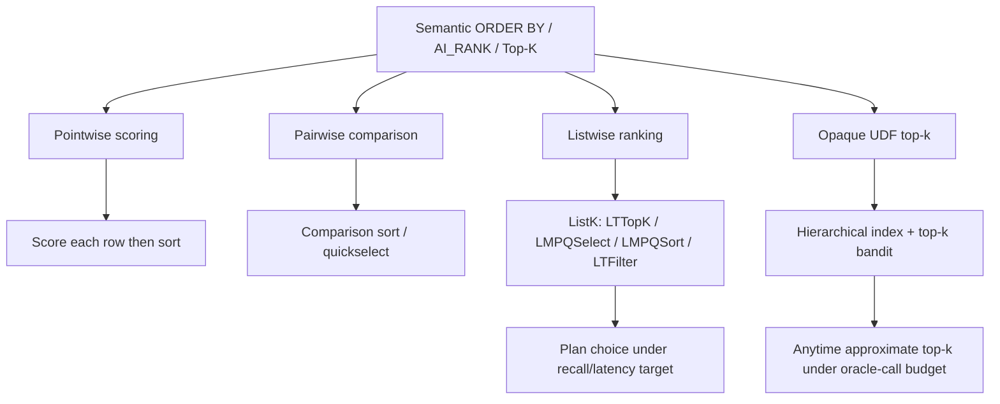

### Query-centric optimization of AI workflows

[Query-Centric Optimization of AI Workflows via AQP and Proxy Models](https://arxiv.org/abs/2607.00254) broadens the SQPE scope from data warehouse SQL to AI workflows themselves.

Key ideas:

- Many AI workflows can be expressed as declarative queries with expensive model predicates or scoring functions.
- LLM post-training rejection sampling can be viewed as `ORDER BY reward_model_score LIMIT K`.
- Agentic classification pipelines can be viewed as semantic predicates inside `WHERE` and `GROUP BY` queries.
- AQP can terminate early once an aggregate estimate and confidence interval are stable.
- Lightweight proxy models can turn structural workflow features into SQL-style predicates, routing only uncertain records to the expensive model.

Why it matters:

This paper suggests that SQPE ideas can optimize not only analytics over enterprise data, but also the internal data workflows of AI systems: reward scoring, filtering, candidate selection, and agentic decision pipelines.

### Related systems and cited work

The operator-specific and query-centric literature also highlights several related systems that should be tracked in the survey:

| Work | Role in the landscape |
|---|---|
| [Kalypso: Relational LLM Serving](https://arxiv.org/abs/2607.23815) | Query-aware LLM serving layer for semantic query plans; adds pipelined execution, cross-operator KV-cache reuse, memory-aware scheduling, and operator execution contracts below systems such as LOTUS and Palimpzest. |
| [vLLM / PagedAttention](https://arxiv.org/abs/2309.06180) | Request-centric LLM serving substrate with efficient KV-cache management and automatic prefix caching; important foundation for SQPE serving layers. |
| [SGLang](https://arxiv.org/abs/2312.07104) | Structured LLM program runtime with prefix-sharing mechanisms; relevant for SQPEs that compile semantic plans into structured LLM programs. |
| [Continuous Prompts](https://arxiv.org/abs/2512.03389) | LLM-augmented processing over unstructured streams; adjacent streaming counterpart to batch SQPE pipelines. |
| [SemPipes](https://arxiv.org/abs/2602.05134) | Optimizable semantic data operators for tabular ML pipelines; broadens SQPE-style operator optimization into ML feature-engineering and data-preparation pipelines. |
| [Task Cascades](https://arxiv.org/abs/2601.05536) | Task-level cascades for unstructured data processing; complements model cascades by using simpler sub-tasks and decompositions as cheaper surrogates. |
| [Deep Research is the New Analytics System](https://arxiv.org/abs/2509.02751) | Positions semantic operators as part of a broader AI-driven analytics runtime that combines optimized query execution with dynamic agentic research workflows. |
| [ListK: Semantic ORDER BY and LIMIT K with Listwise Prompting](https://arxiv.org/abs/2603.17223) | Specialized semantic top-k implementation using listwise rankers, tournament and multi-pivot quickselect/sort algorithms, LTFilter prefiltering, and optimizer-friendly recall/latency cost models. |
| [Approximating Opaque Top-k Queries](https://arxiv.org/abs/2503.20119) | Adjacent AQP/top-k foundation for expensive black-box scoring functions; uses a hierarchical representation index and histogram-based epsilon-greedy bandit to approximate top-k results under an oracle-call budget. |
| [RankLLM](https://arxiv.org/abs/2502.18470) / [RankZephyr](https://arxiv.org/abs/2312.02724) | IR listwise-ranker infrastructure used by ListK; relevant as a physical ranking kernel for SQPE semantic `ORDER BY` access paths. |
| [iPDB: Optimizing SQL Queries with ML and LLM Predicates](https://arxiv.org/abs/2601.16432) | SQL-native DuckDB-based system with model catalog, `LLM`/`PREDICT` clauses, a native `predict` operator, semantic project/select/relation/join/aggregate support, structured typed extraction, prompt deduplication, row marshaling, parallel calls, semantic predicate ordering, select-vs-join ordering, and predicate merging. |
| [LROBench: Large Language Model-Enhanced Relational Operators](https://arxiv.org/abs/2603.02537) | Relation-native taxonomy and benchmark for Filter, Match, Impute, Cluster, and Order operators; useful for evaluating single-operator access paths and multi-LRO system composition. |
| [Aero/Hydro: Adaptive Query Processing of ML Queries](https://arxiv.org/abs/2403.14902) | Adaptive query processing for ML UDF predicates; important predecessor for runtime predicate ordering and routing in ML/semantic query engines and cited by iPDB as a baseline workload/source. |
| [EvaDB](https://github.com/georgia-tech-db/evadb) | SQL-oriented AI database baseline mentioned by iPDB; illustrates the ML/AI-UDF path where inference is exposed through functions but with weaker coverage of table inference, semantic joins, and typed structured extraction. |
| [Extending Relational Query Processing with ML Inference / Raven](https://arxiv.org/abs/1911.00231) | In-RDBMS ML scoring with ONNX Runtime and cross-optimization between ML and DB operators; important DB4AI predecessor to iPDB's native predict-operator approach. |
| [The Duck's Brain](https://arxiv.org/abs/2312.17355) | Implements neural-network training and inference in DuckDB using relational/array representations; relevant to the ML-to-SQL/in-database inference lineage cited by iPDB. |
| [MADlib](https://doi.org/10.14778/2367502.2367510) | Classic SQL-based in-database analytics and ML library; useful historical anchor for model inference/training inside the database. |
| [BioDEX](https://doi.org/10.18653/v1/2023.findings-emnlp.896) | Biomedical adverse-drug-event extraction benchmark used by iPDB to compare against AI-native document processing systems; relevant as a challenging semantic extraction/classification workload. |
| [DuckDB](https://doi.org/10.1145/3299869.3320212) and [MonetDB/X100](https://www.cidrdb.org/cidr2005/papers/P19.pdf) | Execution-engine lineage for vectorized, columnar analytical processing. iPDB, Sema, and FlockMTL show why DuckDB has become a common prototyping base for SQPEs. |
| [Abacus: A Cost-Based Optimizer for Semantic Operator Systems](https://arxiv.org/abs/2505.14661) | Cost-based optimization for semantic operator systems; cited by CADENZA as a baseline/relevant optimizer. |
| [Quest: Query Optimization in Unstructured Document Analysis](https://arxiv.org/abs/2507.06515) | Query optimization for document-analysis workloads; used as a Larch baseline for semantic filter ordering. |
| [PLOP / Horrila: Cost-Based Placement of Semantic Operators in Hybrid Query Plans](https://arxiv.org/abs/2604.09944) | Dynamic-programming placement of semantic operators relative to relational operators; already included above as Horrila/PLOP. |
| [ScaleDoc: Scaling LLM-based Predicates over Large Document Collections](https://arxiv.org/abs/2509.12610) | Online-trained proxy for semantic filtering; key baseline for Fast LLM-Based Semantic Filtering. |
| [Beyond Linear LLM Invocation: An Efficient and Effective Semantic Filter Paradigm](https://arxiv.org/abs/2603.04799) | Model-free or clustering-style semantic filtering family; corresponds to the CSV line of work in the filtering paper. |
| Cut Costs, Not Accuracy: LLM-Powered Data Processing with Guarantees | BARGAIN-style cascade using small proxy models and distribution-free calibration; important for guarantees in semantic filtering and joins. |
| [KEN: An Execution Engine for Unstructured Database Systems](https://www.vldb.org/pvldb/vol19/p902-kossmann.pdf) | Execution-layer support for unstructured database systems, including scheduling/cascade concerns below the optimizer. |
| [Making Prompts First-Class Citizens for Adaptive LLM Pipelines](https://arxiv.org/abs/2508.05012) | Treats prompts as optimizable units in adaptive LLM pipelines; relevant to catalog-level prompt objects and runtime adaptation. |
| [Streaming Model Cascades for Semantic SQL](https://arxiv.org/abs/2604.00660) | Model cascade execution for semantic SQL; relevant to production AI SQL physical operators. |
| [BlendSQL: A Scalable Dialect for Hybrid Question Answering in Relational Algebra](https://arxiv.org/abs/2402.17882) | Hybrid SQL/LLM language for structured and unstructured QA; related to SUQL and Binder. |
| [Hybrid Querying Over Relational Databases and Large Language Models](https://arxiv.org/abs/2408.00884) | Hybrid relational/LLM query framework; related to SQL-native AI query abstractions. |
| Logical and Physical Optimizations for SQL Query Execution over Large Language Models | SQL-over-LLM optimization, including logical and physical rewrites; relevant to Larch and AI SQL optimization. |
| ThalamusDB: Approximate Query Processing on Multi-Modal Data | Approximate query processing for multimodal data; used in SemBench/CADENZA comparisons and relevant to AQP-style SQPEs. |
| [Approximate Selection with Guarantees using Proxies](https://www.vldb.org/pvldb/vol13/p1990-kang.pdf) | Pre-LLM proxy-selection lineage that underlies modern semantic filtering cascades. |
| [Accelerating Machine Learning Inference with Probabilistic Predicates](https://doi.org/10.1145/3183713.3183751) | Earlier SIGMOD work on optimizing expensive ML predicates inside queries; important ancestor for semantic filter pushdown/cascades. |
| [BlazeIt](http://www.vldb.org/pvldb/vol12/p1199-kang.pdf), [NoScope](http://www.vldb.org/pvldb/vol10/p1586-kang.pdf), and related video-query systems | Pre-LLM systems showing how proxy models and specialized models accelerate declarative queries over unstructured/video data. |
| [Wander Join](https://dl.acm.org/doi/10.1145/2882903.2915235) and online aggregation | Classical AQP lineage used by Query-Centric Optimization and BaS. |
| [Eddies](https://doi.org/10.1145/342009.335420) and adaptive query processing | Classical lineage for runtime predicate/operator reordering, newly relevant because LLM calls create enough latency slack for online learning. |

---

## Operator-specific access-path taxonomy

SQPE optimizations can be grouped by cross-cutting mechanism: sampling, proxy models, cascades, placement, batching, caching, deduplication, and rewriting. More recent operator-specific work adds another dimension: **access-path selection per semantic operator**.

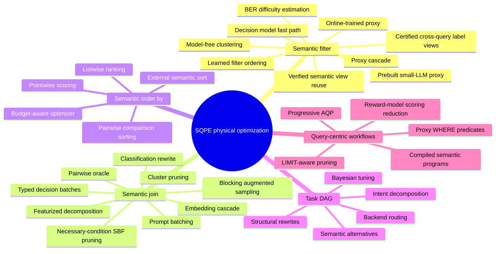

The design implication is that an SQPE optimizer should not only ask:

> Where should I place the semantic operator?

It should also ask:

> Which access path should implement this semantic operator instance, under this predicate, this data distribution, this model budget, and this quality target?

---

## Emerging open problems from operator-specific optimization

### 1. A unified algebra for semantic operators and task DAGs

CADENZA's TxRA suggests one possible path: expose intermediate task outputs as relational attributes. A broader SQPE algebra still needs to reconcile:

- LOTUS-style semantic relational operators,
- UQE/Sema/Snowflake/BigQuery-style SQL functions,
- Palimpzest/DocETL-style AI dataflows,
- CADENZA-style task DAGs,
- query-centric AI workflow operators such as reward-model scoring and agentic predicates.

### 2. Access-path selection for every semantic operator

Relational optimizers have access paths for scans, joins, grouping, and ordering. SQPEs need the same for semantic operators:

- filter access paths: oracle, cascade, proxy, cluster, two-phase,
- join access paths: pairwise, ABJ, embedding cascade, FDJ, classifier rewrite, cluster join, BaS,
- rank access paths: pointwise, pairwise, listwise, external, consensus,
- map/extract access paths: direct LLM, OCR+QA, rule+model, extraction+join, materialized view.

### 3. Semantic selectivity estimation

Larch, BaS, FDJ, and SemJoin all show that semantic selectivity is the central unknown. Future systems need estimates for:

- probability a semantic filter passes for each row,
- probability a semantic join pair matches,
- confidence in a proxy decision,
- expected number of LLM calls under a cascade,
- expected quality degradation under approximate execution,
- cardinality of semantic joins for downstream join ordering.

### 4. Guarantees beyond scalar proxy thresholds

LOTUS and BARGAIN-style cascades often reason about scalar proxy thresholds. FDJ and BaS push guarantees into richer spaces: multi-feature CNF predicates and sampling/blocking regimes. The open problem is how to provide user-comprehensible guarantees for plans composed of multiple approximate semantic operators.

### 5. Runtime learning versus optimizer overhead

Larch highlights a unique property of AI SQL: model calls are so slow that online learning can be hidden behind inference latency. This creates new opportunities for adaptive query processing, but also raises questions:

- How much data is needed before online learning beats static heuristics?
- How should systems avoid overfitting to early rows?
- How should an optimizer account for training overhead, model drift, and delayed feedback?

### 6. Query-centric AI workflows as SQPE workloads

The Query-Centric AI Optimization paper suggests that future SQPEs may optimize ML/LLM workflows themselves. This blurs the boundary between:

- a database query over enterprise data,
- an LLM post-training pipeline,
- an agentic workflow,
- a reward-model filtering/ranking stage,
- a data generation and curation loop.

A practical SQPE may need to optimize all of these under one query-centric cost/quality model.

## Comparison matrix

The following matrix combines core SQPE systems, production platforms, benchmarks, and operator-specific optimization papers into one view.

| System | Interface | Main target | Core semantic operations | Optimization focus | Notes |
|---|---|---|---|---|---|
| [NousDB](https://arxiv.org/abs/2610.28551) | DataFusion relational API / semantic algebra | Relational semantic analytics | Extend, select, join | Conditional algebraic rewrites, token histograms, context/fidelity-aware batching, token-based repartitioning | Singleton-model semantics; fidelity is not ground truth |
| [JEVDB](https://arxiv.org/abs/2610.02046) | Extended SQL and decision-model primitives | Discrete semantic decisions and joins | Filter, classify, score, join | Noul/Choice/Score, Yannakakis reduction, Semantic Bloom Filters, condition index, fallback | SBF losslessness is conditional on sound conditions/extractors |
| [SemViews](https://arxiv.org/abs/2610.12768) | LOTUS-compatible optimizer | Repeated semantic filters over text | Certified semantic filter | Provenance-rich label views, supervised ordering, finite-sample certification | Precision/recall guarantee against fixed oracle reference, not truth |
| [SemBaker](https://arxiv.org/abs/2608.06677) | Semantic-operator execution plugin | Codifiable semantic predicates | Filter, map, join | One-time code synthesis, compiled/native routing | Approximate substitution; not suitable for every semantic intent |
| [Same Query, Different Answer](https://arxiv.org/abs/2610.13823) | Cross-benchmark methodology | Run-to-run reliability | SemBench/LROBench/UDA-Bench operators | Repeated execution, possible-worlds answer reproducibility | Separates output, answer, and score variance |
| [UDA-Bench](https://arxiv.org/abs/2510.27119) | Benchmark | SQL analytics over extracted document attributes | Extract, filter, join, aggregate | Ground-truth relational views and unstructured-query evaluation | Complements SemBench, LROBench, Spider 2.0-AIFunc |
| [UQE](https://arxiv.org/abs/2407.09522) | UQL, SQL-like | Unstructured databases | Filter, retrieval, abstraction aggregation, conditional aggregation | Sampling, compiler-style orchestration, proxy models | Foundational for unstructured-data query processing |
| [LOTUS](https://arxiv.org/abs/2407.11418) | DataFrame/relational API | Text analytics and AI pipelines | Filter, join, rank/sort, cluster, aggregate | Operator implementations, approximate execution, guarantees | Strong semantic-operator abstraction |
| [Palimpzest](https://arxiv.org/abs/2405.14696) | Declarative AI workload spec | AI-powered analytics over unstructured data | Extraction, conversion, filtering, schema matching | Cost, runtime, quality plan search | Broader than SQL, strong optimization framing |
| [DocETL](https://arxiv.org/abs/2410.12189) | Declarative document pipeline | Complex document processing | Extract, map, reduce, validate | Agentic rewrites and evaluation | Focuses on accuracy through plan rewriting |
| [Google proxy models](https://doi.org/10.1145/3802002) | SQL AI operators | BigQuery OLAP and AlloyDB HTAP | AI.IF, AI.RANK | Lightweight proxy models, online/offline training, fallback | Production-oriented scale study |
| [Snowflake Cortex AISQL](https://arxiv.org/abs/2511.07663) | SQL | Production unstructured-data analytics | Semantic SQL operations, joins, classification | AI-aware optimization, cascades, join rewriting | Production SQL engine paper |
| [Sema](https://arxiv.org/abs/2603.11622) | SemaSQL | DuckDB semantic SQL | Classification, extraction, summarization | Adaptive execution, prompt batching, operator fusion | First-class semantic operators in DuckDB |
| [Horrila](https://arxiv.org/abs/2604.09944) | Semantic SQL optimizer | Hybrid relational/semantic plans | Semantic filters and derived rewrites | Cost-based placement | Focused optimizer contribution |
| [FlockMTL](https://arxiv.org/abs/2504.01157) | DuckDB SQL extension | LLM/RAG analytics | Scalar and aggregate model functions | Batching, caching, catalog abstractions | PROMPT and MODEL as schema objects |
| [iPDB](https://arxiv.org/abs/2601.16432) | Extended SQL over DuckDB | In-database ML/LLM inference in relational queries | Semantic project, select, relation generation, join, aggregate, order | Native predict operator, typed output generation, prompt deduplication, row marshaling, predicate placement/merging | Strong engine-integration paper; complements Sema/FlockMTL and operator-specific optimizers |
| [CADENZA](https://arxiv.org/abs/2606.29151) | Semantic operator instance / TxRA | Multimodal semantic operators | Filter, QA, OCR, VQA, extraction, matching as task DAGs | Intent-specific DAG synthesis, backend routing, Bayesian tuning | Strong algebra/optimizer abstraction |
| [Larch](https://arxiv.org/abs/2606.07923) | AI SQL optimizer | Queries with multiple semantic filters | `AI_FILTER` Boolean expression trees | Learned row-specific selectivity and evaluation order | Important for runtime adaptive semantic selectivity |
| [Fast LLM-Based Semantic Filtering](https://arxiv.org/abs/2606.08090) | Physical semantic filter operator | Document corpora | Yes/no semantic filter | Adaptive two-phase cascade, BER lower bound, soft-label proxy training | Unifies CSV, BARGAIN, ScaleDoc |
| [SemJoin](https://arxiv.org/abs/2606.29532) | Semantic join strategy router | Natural-language joins | Classifier join, cluster join, batched LLM matching | LLM advisor chooses join strategy from samples and predicate | Shows semantic join needs access-path selection |
| [FDJ](https://arxiv.org/abs/2512.05399) | Join optimizer | Semantic joins over long/noisy text | Feature extraction + CNF predicate join | Featurized decomposition with precision/recall guarantees | Addresses embedding-similarity failure modes |
| [BaS / WWJ](https://doi.org/10.1145/3802004) | AQP join algorithm | Aggregate joins over unstructured data | Approximate semantic join aggregation | Blocking + importance sampling with confidence intervals | Connects semantic joins to AQP and join-cardinality estimation |
| [LLM ORDER BY access paths](https://arxiv.org/abs/2509.00303) | Semantic order/rank operator | Sorting/ranking by natural-language criteria | `LLM_ORDER_BY`, `AI_RANK` | Pointwise/pairwise/listwise/external sorting and budget-aware access-path selection | Rank/sort counterpart to semantic join access paths |
| [ListK](https://arxiv.org/abs/2603.17223) | Semantic top-k / order physical operator | `ORDER BY <natural-language criterion> LIMIT K` over documents/rows | Semantic top-k, full semantic sort | Listwise rankers, LTTopK, LMPQSelect, LMPQSort, LTFilter, recall/latency cost models | Deepens the listwise access-path branch for semantic ranking |
| [Approximating Opaque Top-k Queries](https://arxiv.org/abs/2503.20119) | Adjacent top-k/AQP optimizer | Expensive opaque scoring UDFs over large datasets | Pointwise black-box score + top-k | Hierarchical cheap-representation index, histogram sketches, DR-submodular epsilon-greedy bandit | Pre-LLM/adjacent foundation for model-scored `ORDER BY ... LIMIT K` workloads |
| [Query-Centric AI Optimization](https://arxiv.org/abs/2607.00254) | Query-centric workflow formulation | AI workflows, post-training, agentic tasks | Expensive predicates, reward-model ranking, aggregate queries | AQP, proxy filtering, structural SQL predicates | Extends SQPE ideas beyond analytics into AI workflow execution |
| [SUQL](https://arxiv.org/abs/2311.09818) | SQL extension | Conversational hybrid search | Structured access plus free-text answer/summary | Semantic parsing and hybrid execution | Strong for structured plus free-text data |
| [Binder](https://arxiv.org/abs/2210.02875) | SQL/Python with LM bindings | Neural-symbolic QA | LM API calls inside symbolic programs | Program generation and execution | Important precursor |
| [Optimizing LLM Queries](https://arxiv.org/abs/2403.05821) | SQL UDF workloads | Relational LLM inference | Classification, extraction, translation via UDFs | KV-cache reuse, deduplication, ordering | Optimizes opaque or semi-opaque LLM calls |
| [Kalypso](https://arxiv.org/abs/2607.23815) | Relational LLM serving API | Serving substrate for semantic query plans | `sem_filter`, `sem_map`, `sem_join`, `sem_classify`, blocking `sem_agg`/`sem_topk` | Pipelining, cross-operator KV-cache reuse, adaptive GPU-memory-aware scheduling, token-bound estimation | Complements SQPE optimizers by making the LLM serving layer query-aware |
| [SemPipes](https://arxiv.org/abs/2602.05134) | Declarative semantic data operators | Tabular ML pipelines | Semantic data operators for ML data preparation | Operator implementation synthesis and pipeline-context-aware optimization | Adjacent SQPE-style system for ML pipelines rather than analytical SQL |
| [Continuous Prompts](https://arxiv.org/abs/2512.03389) | Stream-processing framework | Unstructured streams | LLM-augmented continuous pipeline operators | Pipeline execution over streams with semantic processing | Adjacent streaming runtime for semantic operators |
| [EVAPORATE](https://arxiv.org/abs/2304.09433) | Extraction-to-table pipeline | Data lakes | Structured-view generation | Code synthesis, weak supervision, sublinear LLM use | Adjacent materialization-first path |
| [LROBench](https://arxiv.org/abs/2603.02537) | Benchmark | Relation-native LLM-enhanced operators | Filter, Match, Impute, Cluster, Order | Single-LRO and multi-LRO operator/access-path evaluation | Complements SemBench with operator-granularity and implementation-variant analysis |
| [Spider 2.0-AIFunc](https://arxiv.org/abs/2607.06229) | Benchmark / AI-native text-to-SQL | NL-to-SQL over production AI functions | Snowflake Cortex `AI_CLASSIFY`, `AI_FILTER`, `AI_SENTIMENT`, `AI_SIMILARITY`, `AI_EXTRACT`, `AI_AGG` composed with SQL | Agent-based task construction, deterministic verification, execution accuracy with same-window gold/predicted execution | Complements SemBench/LROBench by evaluating whether models can synthesize correct AI-native SQL workflows |
| [SemBench](https://arxiv.org/abs/2511.01716) | Benchmark | SQPE evaluation | Filter, join, map, rank, classify | Evaluation dimensions | Defines benchmark scope |
| [Meta Engine](https://arxiv.org/abs/2602.01701) | Meta-query system | Heterogeneous semantic engines | Routing across systems | Adapters, routing, aggregation | System-of-systems view |

---

## Optimization taxonomy

SQPE optimizations can be grouped into several categories.

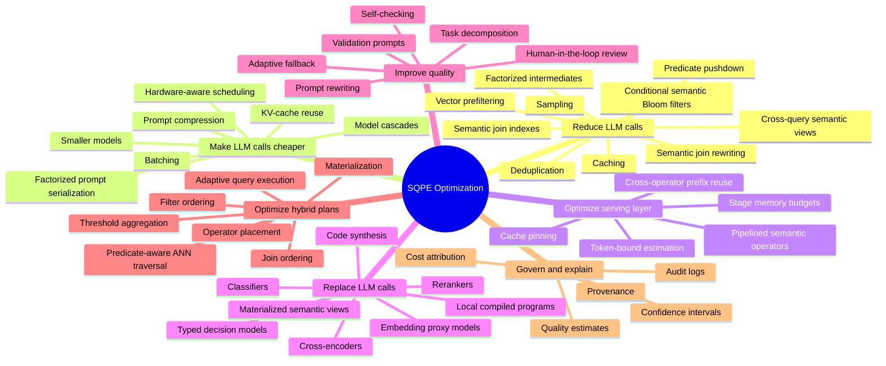

### 1. Sampling and approximate query processing

Used by [UQE](https://arxiv.org/abs/2407.09522), [LOTUS](https://arxiv.org/abs/2407.11418), and related systems.

Goal: avoid evaluating every row with an expensive model.

Techniques:

- random sampling,
- stratified sampling,
- active learning,
- progressive sampling,
- confidence intervals,
- approximate aggregation,
- fallback to full evaluation when approximation fails.

Open questions:

- How to estimate semantic predicate selectivity before execution?
- How to sample rare semantic classes?
- How to handle multimodal predicates?
- How to compose multiple approximate semantic operators with guarantees?

**Cross-query reuse as a physical access path.** Caching a prior `sem_filter` decision for another prompt is not merely a cache lookup: semantic equivalence is approximate and the oracle itself can vary. SemViews uses stored label views, helper scores, and embeddings to shape a candidate ordering, and then certifies with **fresh** finite-sample oracle evidence. SemWeave uses entailment/common-expression detection to propose direct reuse; it illustrates the savings opportunity and the need to distinguish heuristic reuse from certified execution. See the dedicated discussion under operator-specific optimization.

### 2. Proxy models and model substitution

Used by [UQE](https://arxiv.org/abs/2407.09522), [Google proxy-model AI query approximation](https://doi.org/10.1145/3802002), and [Snowflake Cortex AISQL](https://arxiv.org/abs/2511.07663).

Goal: replace many expensive LLM calls with cheaper models.

Typical workflow:

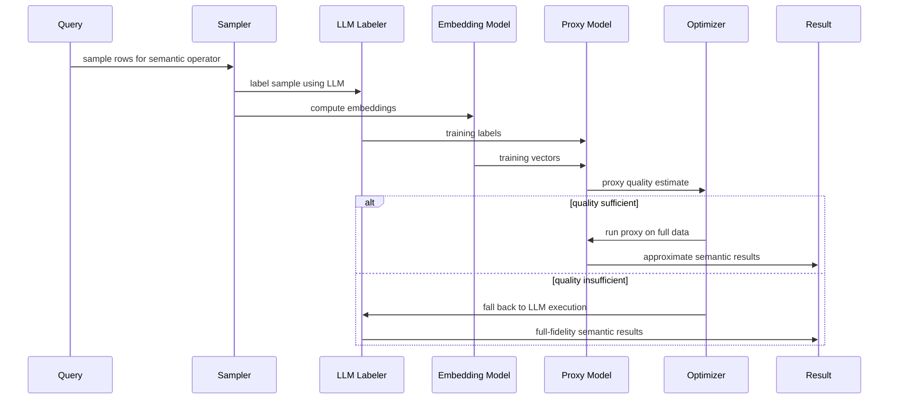

Key design choices:

- online training for ad hoc OLAP queries,
- offline training for repeated HTAP/application queries,
- automatic proxy evaluation,
- thresholds for fallback,
- imbalanced-label handling,
- embedding model selection,
- monitoring for drift.

### 3. Model cascades

Used by Snowflake Cortex AISQL and related work.

Goal: send easy examples to cheap models and hard examples to stronger models.

A common pattern:

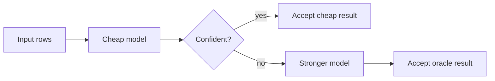

Open questions:

- How to calibrate confidence across models?
- How to enforce query-level quality constraints?
- How to combine cascades with relational operator placement?
- How to cost cascades during optimization?

### 4. Semantic operator placement

Studied directly by [Horrila](https://arxiv.org/abs/2604.09944).

Classic relational optimizers decide join order, access methods, and predicate pushdown. SQPEs must decide where to place expensive semantic operators relative to relational operators.

Example tradeoff:

- Early semantic filter: fewer downstream rows, more LLM calls.
- Late semantic filter: fewer distinct semantic calls due to deduplication/caching, but more relational processing.

This is a new version of predicate pushdown where the predicate itself may cost orders of magnitude more than scanning or joining rows.

### 5. Batching, caching, and deduplication

Used by [Optimizing LLM Queries in Relational Workloads](https://arxiv.org/abs/2403.05821), [Kalypso](https://arxiv.org/abs/2607.23815), [FlockMTL](https://arxiv.org/abs/2504.01157), [Sema](https://arxiv.org/abs/2603.11622), and production systems.

Important opportunities:

- Batch many row-level model calls.
- Cache repeated prompts and repeated inputs.
- Deduplicate equivalent requests.
- Reorder rows to improve KV-cache reuse.
- Reorder columns or prompt fragments to maximize common prefixes.
- Share embeddings across queries.
- Materialize semantic intermediate results.
- Pipeline dependent semantic operators to preserve tuple-context prefixes in the KV cache.
- Allocate serving memory across pipeline stages based on observed starvation, saturation, selectivity, and fanout.

**Engine-side batching, token skew, and compiled execution.** NousDB makes token-length histograms and batch fidelity part of relational physical optimization: avoiding context overflow is distinct from retaining per-row singleton model outputs. SemBaker introduces native-versus-compiled execution as another access path, synthesizing a local Python operator once when the predicate can be codified. JEVDB instead retains learned inference but substitutes a specialized non-autoregressive typed decision model when the output domain is bounded. These are distinct ways to lower *cost per semantic decision*, and none is unconditionally semantics-preserving.

### 6. Serving-aware execution and LLM serving

Kalypso adds a serving-layer optimization category that sits below the SQPE optimizer but above the raw LLM engine. The core issue is that request-centric LLM serving cannot tell that two prompts belong to adjacent semantic operators in the same query plan. If the shared tuple prefix is evicted between operators, the downstream operator recomputes expensive prefill work.

Important techniques:

- expose semantic query plans, pipeline stages, and operator execution contracts to the serving layer;
- schedule downstream work soon enough to reuse cached tuple prefixes;
- avoid flooding memory with upstream work that will evict prefixes before reuse;
- adapt stage budgets online based on queue pressure, selectivity, fanout, and memory utilization;
- use token-bound estimation so generative operators reserve enough memory without destroying parallelism;
- support virtual or explicit KV-cache pinning depending on the underlying LLM serving engine.

This optimization category is orthogonal to model cascades and proxy models: cascades reduce how many oracle calls are needed, while relational LLM serving makes the remaining calls execute more efficiently.


### 7. Factorized, indexed, and retrieval-prefilter execution

Used by [FFX](https://arxiv.org/abs/2609.09002), [DASE](https://arxiv.org/abs/2609.19491), and related vector-relational systems.

Goal: reduce semantic cost before or during model invocation by preserving compact relational structure, pre-linking high-value candidate pairs, or returning a high-recall candidate set for downstream semantic operators.

Important techniques:

- preserve factorized join intermediates instead of flattening them before an LLM call;
- serialize factorized vectors into compact prompts;
- maintain sparse semantic-join indexes for rare embedding-neighbor pairs;
- combine structured predicates, ANN traversal, exact joins, and thresholded embedding-similarity joins in one execution layer;
- use threshold-based top-k aggregation over multiple similarity and structured scoring signals;
- pass candidate sets to downstream semantic filters, joins, or answer-synthesis operators.

This category sits between relational optimization and semantic-operator execution. It is especially relevant for join-heavy SQPE workloads, graph/path-shaped analytical tasks, scientific-discovery agents, and workloads where most LLM cost arises only after a large candidate-evidence space has been constructed.

### 8. Query and prompt rewriting

Used by [DocETL](https://arxiv.org/abs/2410.12189), [Sema](https://arxiv.org/abs/2603.11622), and related systems.

Goal: improve reliability or reduce cost by rewriting the semantic task.

Examples:

- Split long documents into chunks before extraction.
- Turn broad instructions into narrower subqueries.
- Add validation prompts.
- Rewrite a join into classification over candidate labels.
- Compress natural-language predicates.
- Infer relational constraints from semantic predicates.

---

## Accuracy, cost, and latency tradeoffs

The central SQPE tradeoff is no longer just query latency versus resource usage. It is a multi-objective optimization problem:

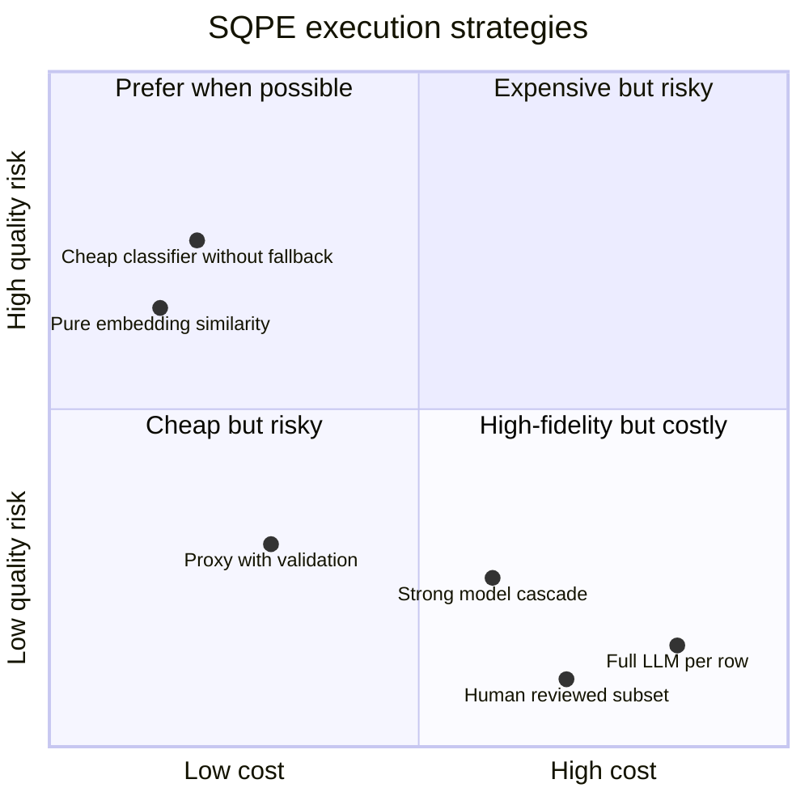

For many enterprise workloads, the right system behavior is not "always use the strongest model." It is:

1. use the cheapest method that satisfies the query's quality constraint,
2. estimate whether the constraint is satisfied,
3. fall back when it is not,
4. log enough evidence to audit the decision.

---

## What the Google proxy-model paper changes

The Google/SIGMOD 2026 paper [100x Cost & Latency Reduction](https://doi.org/10.1145/3802002) is important because it makes proxy models a first-class architectural component for production SQPEs.

The main lesson is:

> A semantic operator does not always need to be executed by the model that defines its semantics.

For example, an LLM may define the intended semantics of `AI.IF('review is positive', review)`, but after a small number of LLM-labeled examples, the execution engine may use an embedding-based logistic regression proxy for the rest of the table, as long as the proxy passes an automatic quality check.

This creates a useful distinction:

| Concept | Meaning |
|---|---|
| Semantic specification model | The model or prompt that defines the intended semantics. |
| Execution model | The actual physical implementation used for most rows. |
| Proxy model | A cheaper learned approximation of the semantic specification. |
| Fallback model | A stronger model used when proxy quality is insufficient. |
| Quality gate | A validation rule deciding whether proxy execution is acceptable. |

This distinction is analogous to classic DBMS physical independence. The user specifies the query declaratively; the engine chooses the physical strategy.

---

## SQPEs versus adjacent systems

### SQPEs versus text-to-SQL

Text-to-SQL maps natural language to SQL over existing structured schemas. SQPEs extend the execution model itself so that SQL or relational plans can contain semantic operations.

A text-to-SQL system answers:

> What SQL query should I generate?

An SQPE answers:

> How should I execute this query when some predicates, joins, projections, or aggregations require semantic model reasoning?

The two are complementary. A natural-language interface may generate an SQPE query. Spider 2.0-AIFunc makes this boundary explicit: the generated SQL itself may contain production AI functions, so the text-to-SQL front end must reason not only about tables, joins, and aggregation, but also about which AI function to call, which columns to pass, which labels or extraction schemas to specify, and where the AI call belongs in the relational plan.

### SQPEs versus RAG

RAG retrieves documents and asks an LLM to answer. SQPEs expose retrieval, filtering, joining, ranking, extraction, and aggregation as composable operators.

A RAG system often answers one question at a time. An SQPE can express bulk analytics such as:

- count customers whose support transcripts show unresolved billing frustration,
- join product reviews to product metadata using semantic compatibility,
- extract contract clauses and aggregate by clause type,
- rank documents by a task-specific rubric,
- compute approximate statistics over semantic predicates.

### SQPEs versus vector databases

Vector databases provide similarity search and indexing. SQPEs may use vector search as a physical operator, but semantic queries often require more than similarity:

- natural-language boolean predicates,
- joins,
- aggregation,
- extraction,
- classification,
- multimodal reasoning,
- provenance and auditability,
- integration with structured filters and relational plans.

### SQPEs versus data-cleaning or information-extraction systems

Systems such as [EVAPORATE](https://arxiv.org/abs/2304.09433) materialize structured views from unstructured data. SQPEs may either materialize semantic views or evaluate semantic operators at query time. The distinction is a physical design choice:

- materialize first when queries are repeated and schema is stable,
- evaluate at query time when queries are ad hoc or semantics change frequently.

---

## Product landscape

| Platform | Current SQPE-relevant capabilities | SQPE maturity assessment |
|---|---|---|
| [Google BigQuery](https://cloud.google.com/bigquery) | BigQuery ML, remote models, ML.GENERATE_TEXT, object tables, vector search, and research prototypes/papers around AI.IF and AI.RANK | Strong building blocks plus production-oriented research on proxy optimization |
| [Google AlloyDB](https://cloud.google.com/alloydb) | HTAP/PostgreSQL-compatible database with AI integrations and vector capabilities | Important for low-latency semantic database applications |
| [Snowflake Cortex](https://docs.snowflake.com/en/user-guide/snowflake-cortex) | Cortex LLM functions, Cortex Search, Cortex AISQL research paper | Very strong production SQPE direction with AI-aware optimization |
| [Databricks](https://docs.databricks.com/aws/en/sql/language-manual/functions/ai_query) | SQL AI functions such as ai_query, Mosaic AI model serving, vector search, Unity Catalog governance | Strong AI-enabled lakehouse; optimizer-visible semantic operators are the key question |
| [DuckDB ecosystem](https://duckdb.org/) | Research systems such as Sema and FlockMTL; extension-friendly analytical engine | Strong academic/prototyping platform for embedded SQPEs |
| PostgreSQL ecosystem | pgvector, extensions, external model calls | Strong vector-relational foundation; less unified SQPE semantics by default |
| Lakehouse engines | Spark, Presto/Trino, Velox, DataFusion | Strong execution backends; opportunity to add semantic operators natively |

Snowflake's product surface also now includes explicit AI-function evaluation and optimization primitives. `AI_FUNCTION_EVALUATION` measures output quality of an AI function or Cortex call against a labeled dataset and reports quality, cost, and token usage. `AI_FUNCTION_OPTIMIZATION` searches across prompt and model configurations, evaluates candidates against a consistent dataset and metric, and records quality/cost frontier candidates. These features are product signals that SQPE evaluation, prompt/model selection, and cost-quality tradeoff management are moving into the database platform itself.

---

## Benchmarking and evaluation dimensions

In addition to SemBench, LROBench, and Spider 2.0-AIFunc, [UDA-Bench](https://arxiv.org/abs/2510.27119) tests end-to-end analytics where extracted document attributes behave like relational columns. [Same Query, Different Answer](https://arxiv.org/abs/2610.13823) shows why a complete experimental protocol must additionally characterize the variability of fixed plans, not only average correctness. A strong cross-system comparison must hold model **and serving stack** constant when possible, include repeated executions, and distinguish stochastic oracle disagreements from plan-induced approximation.

SQPE benchmarks need to cover more than accuracy.

```mermaid
flowchart TD
    A[SQPE Benchmark] --> B[Operator coverage]
    A --> C[Data modalities]
    A --> D[Workload shape]
    A --> E[Quality metrics]
    A --> F[Systems metrics]
    A --> G[Governance metrics]
    A --> H[AI-native SQL synthesis]

    B --> B1[Filter]
    B --> B2[Join]
    B --> B3[Map/extract]
    B --> B4[Rank]
    B --> B5[Aggregate]

    C --> C1[Structured tables]
    C --> C2[Text]
    C --> C3[Images]
    C --> C4[Audio]
    C --> C5[Documents]

    D --> D1[Ad hoc OLAP]
    D --> D2[Repeated application query]
    D --> D3[Interactive conversation]
    D --> D4[Batch pipeline]

    E --> E1[Accuracy/F1]
    E --> E2[nDCG]
    E --> E3[Calibration]
    E --> E4[Human preference]

    F --> F1[Latency]
    F --> F2[Throughput]
    F --> F3[Dollar cost]
    F --> F4[Token count]
    F --> F5[Scalability]

    G --> G1[Provenance]
    G --> G2[Reproducibility]
    G --> G3[Privacy]
    G --> G4[Auditability]

    H --> H1[Function selection]
    H --> H2[Function parameterization]
    H --> H3[Schema grounding for AI calls]
    H --> H4[Same-window execution determinism]
```

[SemBench](https://arxiv.org/abs/2511.01716), [LROBench](https://arxiv.org/abs/2603.02537), [Spider 2.0-AIFunc](https://arxiv.org/abs/2607.06229), and [The Stochastic Shift](https://arxiv.org/abs/2609.21133) now cover complementary parts of the evaluation space. SemBench is the best starting point for broad SQPE execution evaluation across modalities and semantic-query scenarios. LROBench is the best starting point for relation-native, operator-level evaluation because it isolates Filter, Match, Impute, Cluster, and Order across operand granularities and implementation variants. Spider 2.0-AIFunc is the best starting point for AI-native text-to-SQL evaluation because it tests whether agents can generate SQL that correctly composes conventional relational logic with platform AI functions. The Stochastic Shift is the best starting point for the evaluation-methodology problem: how to judge AI-operator SQL when exact execution equality is too strict.

Future benchmarks should add:

- larger enterprise-like data lakes,
- repeated workloads that make offline proxies and materialized semantic views meaningful,
- adversarial and drift scenarios,
- schema evolution,
- mixed structured/unstructured joins,
- quality/cost service-level objectives,
- provenance and evidence requirements,
- access-control and privacy constraints,
- human-in-the-loop validation workflows,
- explicit operator-access-path labels, including batched, per-item, semi-join, pairwise, sort, and score-based LLM execution,
- workload suites that separate single-operator access-path evaluation from end-to-end multi-operator planning,
- evaluation protocols that separately score deterministic relational logic and stochastic AI semantics,
- hybrid SQL-plus-external-evidence tasks that test whether agents preserve constraints across tools.

---

## Open research problems

### 1. Logical semantics for AI operators

For relational operators, semantics are precise. For AI operators, semantics are prompt/model dependent and may be nondeterministic.

Open questions:

- What is the formal meaning of a semantic predicate?
- Is the prompt part of the query semantics, the physical plan, or both?
- How should model versioning affect query reproducibility?
- Can semantic operators have type systems?
- What equivalence rules are valid for semantic operators?

### 2. Cost models

Traditional cost models estimate CPU, I/O, network, and cardinality. SQPEs must estimate:

- LLM token cost,
- model latency,
- batching effects,
- cache hit rates,
- embedding cost,
- vector index cost,
- proxy training cost,
- proxy inference cost,
- fallback probability,
- quality risk.

A semantic cost model may need to predict both cost and expected quality.

### 2a. Runtime and serving-layer optimization

Kalypso makes the serving substrate part of the SQPE research agenda. Once a semantic optimizer selects a plan, the runtime still needs to decide how to execute the remaining LLM calls under GPU memory pressure.

Open questions:

- What operator metadata should an SQPE expose to the LLM serving layer?
- Can query optimizers and LLM-serving schedulers share a single cost model?
- How should a system co-optimize batching, prefix caching, pipeline parallelism, and model cascades?
- When should intermediate semantic results be materialized versus pipelined?
- How can serving-layer nondeterminism, retries, evictions, and memory estimates be made auditable?
- Can commercial AI SQL platforms expose enough serving controls without leaking implementation details?

### 3. Selectivity estimation for semantic predicates

A predicate like:

```sql
WHERE AI_IF(review, 'mentions discomfort caused by the product')
```

has no obvious histogram. The engine may need:

- sample-based selectivity estimation,
- embedding-space density estimates,
- learned selectivity models,
- prompt-aware statistics,
- cached results from prior semantic queries.

### 4. Semantic join optimization

Semantic joins are particularly challenging because naive execution is quadratic.

Promising techniques:

- vector prefiltering,
- blocking,
- learned candidate generation,
- rewrite to classification,
- multi-label classification over small-domain keys,
- cascade from cheap similarity to expensive LLM verification,
- reuse across repeated join keys.

Systems such as [LOTUS](https://arxiv.org/abs/2407.11418), [Snowflake Cortex AISQL](https://arxiv.org/abs/2511.07663), and [Horrila](https://arxiv.org/abs/2604.09944) make this a central research direction.

### 5. Quality guarantees

Users need to know when approximate semantic execution is acceptable.

Possible approaches:

- confidence intervals from sampling,
- held-out LLM-labeled validation sets,
- proxy-vs-oracle agreement tests,
- human-labeled calibration sets,
- query-level error bounds,
- operator-level quality contracts,
- adaptive fallback.

The hard part is composition. Even if each operator has a quality estimate, the whole plan may amplify errors.

### 6. Reproducibility and determinism

SQPEs rely on models whose behavior may vary by version, temperature, provider, context length, and hidden serving changes.

Needed mechanisms:

- model version pinning,
- prompt versioning,
- deterministic decoding when possible,
- cached semantic results,
- evidence logging,
- replayable query plans,
- provenance for model-derived values.

**Distinguish the objects being guaranteed.** A precise survey should distinguish: (i) answer correctness against human labels, (ii) agreement with an LLM oracle/reference plan, (iii) precision/recall under a finite-sample failure probability, (iv) the conditional safety of necessary-condition pruning, and (v) reproducibility across different executions or deployments. SemViews establishes (iii) relative to (ii); NousDB's batch test controls per-item agreement with singleton reference execution; JEVDB's SBF contract is lossless only with sound constraints/extractors. None alone establishes all five properties. [Same Query, Different Answer](https://arxiv.org/abs/2610.13823) motivates recording the reference model's output distribution and the entire deployment, not only its name and temperature.

### 7. Governance and security

Enterprise SQPEs must handle:

- row-level and column-level access control,
- prompt injection from data values,
- data exfiltration through model calls,
- cross-tenant leakage in shared model services,
- compliance logging,
- sensitive-data redaction,
- policy-aware retrieval and generation.

This is especially important for systems that combine SQL engines, vector indexes, object stores, and external model APIs.

### 8. Integration with enterprise semantic layers

Most current SQPE work focuses on row-level semantic operators over data. Enterprise deployments also need semantic layers over schemas, metrics, business terms, policies, and data products.

Open questions:

- How should semantic operators interact with a business ontology or metric layer?
- Can an SQPE discover relevant tables and columns automatically?
- Can it produce grounded answers with lineage through schema mappings and semantic metadata?
- How should semantic query planning span structured tables, documents, metadata catalogs, and knowledge graphs?

---

## Implications for SQPE system design

A practical SQPE should probably include the following components:

1. **Declarative semantic operator layer**
   - filter, map, extract, classify, join, rank, aggregate, summarize.

2. **Model abstraction layer**
   - LLMs, embedding models, rerankers, classifiers, proxy models, multimodal models.

3. **Semantic catalog**
   - prompts, models, embeddings, proxies, semantic indexes, evaluation sets, model versions.

4. **AI-aware optimizer**
   - cost, latency, quality, selectivity, privacy, model availability.

5. **Approximation framework**
   - sampling, proxy training, cascades, fallback, confidence estimation.

6. **Execution runtime**
   - batching, caching, concurrency control, vector search, model-serving adapters.

7. **Provenance and observability**
   - evidence rows, model calls, prompts, token counts, confidence, audit traces.

8. **Governance and safety layer**
   - access control, redaction, prompt-injection defenses, tenant isolation.

---

## Suggested taxonomy for future papers

When positioning a new SQPE paper, classify it along these dimensions:

| Dimension | Possible values |
|---|---|
| Interface | SQL, SQL dialect, DataFrame, declarative pipeline, conversational, API |
| Data | structured, text, documents, images, audio, video, multimodal |
| Operators | filter, map, extract, classify, join, rank, aggregate, summarize |
| Semantics | prompt-defined, model-defined, schema-defined, ontology-guided, human-labeled |
| Execution | per-row LLM, batched LLM, RAG, vector prefilter, proxy, cascade, materialized view |
| Optimization | rule-based, cost-based, adaptive, agentic rewrite, learned optimizer |
| Quality control | none, validation set, sampling guarantee, human labels, fallback, confidence bounds |
| Deployment | prototype, embedded DB, distributed engine, warehouse, lakehouse, HTAP |
| Governance | model logging, provenance, access control, policy enforcement, auditability |

---

## Recommended reading path

For a concise but deep entry into the area:

1. [Semantic Operators: A Declarative Model for Rich, AI-based Analytics Over Text Data](https://arxiv.org/abs/2407.11418) - read first for the semantic-operator abstraction.
2. [UQE: A Query Engine for Unstructured Databases](https://arxiv.org/abs/2407.09522) - read for SQL-like unstructured data querying and proxy/sampling ideas.
3. [100x Cost & Latency Reduction](https://doi.org/10.1145/3802002) - read for production-oriented proxy-model architecture in BigQuery and AlloyDB contexts.
4. [Cortex AISQL](https://arxiv.org/abs/2511.07663) - read for production semantic SQL optimization in Snowflake.
5. [SemBench](https://arxiv.org/abs/2511.01716) - read for benchmark scope and system comparison.
6. [LROBench](https://arxiv.org/abs/2603.02537) - read for relation-native LLM-enhanced operator taxonomy, operand granularity, and implementation-variant evaluation.
7. [Spider 2.0-AIFunc](https://arxiv.org/abs/2607.06229) - read for AI-native text-to-SQL generation over production SQL-callable AI functions.
8. [Palimpzest](https://arxiv.org/abs/2405.14696) and [DocETL](https://arxiv.org/abs/2410.12189) - read for declarative AI pipeline optimization.
9. [Horrila](https://arxiv.org/abs/2604.09944), [Sema](https://arxiv.org/abs/2603.11622), and [FlockMTL](https://arxiv.org/abs/2504.01157) - read for emerging DBMS-level optimizer and runtime directions.
10. [Optimizing LLM Queries in Relational Workloads](https://arxiv.org/abs/2403.05821) - read for model-serving optimizations inside relational workloads.
11. [SUQL](https://arxiv.org/abs/2311.09818) and [Binder](https://arxiv.org/abs/2210.02875) - read for hybrid symbolic/neural language design.

---

## References

### Core SQPE papers

- [NousDB - A Fast Query Engine for Semantic Analytics](https://arxiv.org/abs/2610.28551). Christos Tsapelas, Georgia Koutrika, Yannis Ioannidis. arXiv:2610.28551, 2026. Version 1 requested; v2 was posted October 21, 2026.
- [Prune First, Decide Fast: Scalable Semantic Query Processing with JEVDB](https://arxiv.org/abs/2610.02046). Zhengle Wang, Hanxu Yan, Fuheng Zhao, Chunwei Liu. arXiv:2610.02046, 2026.
- [Semantic Views: Certified Reuse of LLM Labels Across Semantic Queries](https://arxiv.org/abs/2610.12768). Oktie Hassanzadeh, Dharmashankar Subramanian. arXiv:2610.12768, 2026. [Code/data](https://github.com/semviews/lotus-semviews).
- [Demo of SemWeave: Semantic Common Expressions for LLM-powered Query Processing](https://doi.org/10.1145/3788853.3801593). Md. Tareq Mahmood, Venkatesh Emani, Hangdong Zhao, Shivaram Venkataraman. SIGMOD Companion, 2026.

- [Semantic Operators: A Declarative Model for Rich, AI-based Analytics Over Text Data](https://arxiv.org/abs/2407.11418). Liana Patel, Siddharth Jha, Parth Asawa, Melissa Pan, Carlos Guestrin, Matei Zaharia. 2024.
- [UQE: A Query Engine for Unstructured Databases](https://arxiv.org/abs/2407.09522). Hanjun Dai, Bethany Yixin Wang, Xingchen Wan, Bo Dai, Sherry Yang, Azade Nova, Pengcheng Yin, Phitchaya Mangpo Phothilimthana, Charles Sutton, Dale Schuurmans. 2024.
- [A Declarative System for Optimizing AI Workloads](https://arxiv.org/abs/2405.14696). Chunwei Liu, Matthew Russo, Michael Cafarella, Lei Cao, Peter Baille Chen, Zui Chen, Michael Franklin, Tim Kraska, Samuel Madden, Gerardo Vitagliano. 2024.
- [DocETL: Agentic Query Rewriting and Evaluation for Complex Document Processing](https://arxiv.org/abs/2410.12189). Shreya Shankar, Tristan Chambers, Tarak Shah, Aditya G. Parameswaran, Eugene Wu. 2024.
- [100x Cost & Latency Reduction: Performance Analysis of AI Query Approximation using Lightweight Proxy Models](https://doi.org/10.1145/3802002). Yeounoh Chung, Rushabh Desai, Jian He, Yu Xiao, Thibaud Hottelier, Yves-Laurent Kom Samo, Pushkar Khadilkar, Xianshun Chen, Sam Idicula, Fatma Özcan, Alon Halevy, Yannis Papakonstantinou. Proc. ACM Manag. Data / SIGMOD 2026. See also [arXiv:2603.15970](https://arxiv.org/abs/2603.15970).
- [Cortex AISQL: A Production SQL Engine for Unstructured Data](https://arxiv.org/abs/2511.07663). Paritosh Aggarwal et al. 2025.
- [SemBench: A Benchmark for Semantic Query Processing Engines](https://arxiv.org/abs/2511.01716). Jiale Lao et al. 2025.
- [Large Language Model-Enhanced Relational Operators: Taxonomy, Benchmark, and Analysis / LROBench](https://arxiv.org/abs/2603.02537). Yunxiang Su, Tianjing Zeng, Zhongjun Ding, Yin Lin, Rong Zhu, Zhewei Wei, Bolin Ding, Jingren Zhou. 2026.
- [Spider 2.0-AIFunc: Extending Real-World Text-to-SQL to AI-Native SQL Workflows](https://arxiv.org/abs/2607.06229). Tianyang Liu, Canwen Xu, Fangyu Lei, Nikki Lijing Kuang, Jixuan Chen, Tao Yu, Julian McAuley, Zhewei Yao, Yuxiong He. 2026.
- [The Stochastic Shift: A New Evaluation Paradigm for Text-to-SQL with AI Operators](https://arxiv.org/abs/2609.21133). Tarfah Alrashed, Fatma Ozcan, Per Jacobsson, Tal Neiman, Xianshun Chen. 2026.
- [Benchmarking Hybrid Deep Research Across Database Querying and Web Search](https://arxiv.org/abs/2609.09410). Ruofan Wu, Peiran Xu, Xiaolong Li, Fan Shu, Soyoung Yoon, Yite Wang, Xiaodong Yu, Boyi Liu, Feng Yan, Debiao Li, Yuxiong He, Zhewei Yao. 2026.
- [Horrila: Cost-Based Placement of Semantic Operators in Hybrid Query Plans](https://arxiv.org/abs/2604.09944). Qiuyang Mang et al. 2026.
- [Sema: A High-performance System for LLM-based Semantic Query Processing](https://arxiv.org/abs/2603.11622). Kangkang Qi et al. 2026.
- [Beyond Quacking: Deep Integration of Language Models and RAG into DuckDB](https://arxiv.org/abs/2504.01157). Anas Dorbani, Sunny Yasser, Jimmy Lin, Amine Mhedhbi. 2025.
- [Optimizing LLM Queries in Relational Workloads](https://arxiv.org/abs/2403.05821). Shu Liu et al. 2024.
- [Meta Engine: A Unified Semantic Query Engine on Heterogeneous LLM-Based Query Systems](https://arxiv.org/abs/2602.01701). Ruyu Li et al. 2026.


### Operator-specific optimizer and query-centric workflow papers

- [CADENZA: Compiling Natural-Language Intent into Task-Specific Operator DAGs for Semantic Query Processing](https://arxiv.org/abs/2606.29151). Jaehyun Ha, Yongjoo Park, Wook-Shin Han. SIGMOD 2027 / arXiv 2026.
- [Larch: Learned Query Optimization for Semantic Predicates](https://arxiv.org/abs/2606.07923). Fuheng Zhao, Pawel Liskowski, Zihan Li, Benjamin Han, Puxuan Yu, Varich Boonsanong, Dimitris Tsirogiannis, Anupam Datta. 2026.
- [Fast LLM-Based Semantic Filtering: From a Unified Framework to an Adaptive Two-Phase Method](https://arxiv.org/abs/2606.08090). Kyoungmin Kim, Martin Catheland, Anastasia Ailamaki. 2026.
- [SemJoin: Semantic Join Optimization](https://arxiv.org/abs/2606.29532). Christopher Gou, Aditya Banerjee, Jiaxuan Wang, Chunwei Liu. VLDB 2026 Workshop: NOVAS / arXiv 2026.
- [Featurized-Decomposition Join: Low-Cost Semantic Joins with Guarantees](https://arxiv.org/abs/2512.05399). Sepanta Zeighami, Shreya Shankar, Aditya Parameswaran. 2025.
- [Accelerating Approximate Analytical Join Queries over Unstructured Data with Statistical Guarantees](https://doi.org/10.1145/3802004). Yuxuan Zhu, Tengjun Jin, Chenghao Mo, Daniel Kang. Proc. ACM Manag. Data / SIGMOD 2026.
- [Access Paths for Efficient Ordering with Large Language Models](https://arxiv.org/abs/2509.00303). Fuheng Zhao, Jiayue Chen, Yiming Pan, Tahseen Rabbani, Sohaib, Divyakant Agrawal, Amr El Abbadi, Paritosh Aggarwal, Anupam Datta, Dimitris Tsirogiannis. 2025/2026.
- [ListK: Semantic ORDER BY and LIMIT K with Listwise Prompting](https://arxiv.org/abs/2603.17223). Jason Shin, Jiwon Chang, Fatemeh Nargesian. 2026.
- [Approximating Opaque Top-k Queries](https://arxiv.org/abs/2503.20119). Jiwon Chang, Fatemeh Nargesian. Proc. ACM Manag. Data 2025.
- [RankLLM: A Framework for Ranking with Large Language Models](https://arxiv.org/abs/2502.18470). Shervin Sharifymoghaddam et al. 2025.
- [RankZephyr: Effective and Robust Zero-Shot Listwise Reranking is a Breeze!](https://arxiv.org/abs/2312.02724). Ronak Pradeep, Sahel Sharifymoghaddam, Jimmy Lin. 2023.
- [Query-Centric Optimization of AI Workflows via Approximate Query Processing and Proxy Models](https://arxiv.org/abs/2607.00254). Huayi Wang, Jun Xu, Gromit Yeuk-Yin Chan. 2026.
- [iPDB: Optimizing SQL Queries with ML and LLM Predicates](https://arxiv.org/abs/2601.16432). Udesh Kumarasinghe, Tyler Liu, Chunwei Liu, Walid G. Aref. 2026.
- [Aero/Hydro: Adaptive Query Processing of ML Queries](https://arxiv.org/abs/2403.14902). Gaurav Tarlok Kakkar, Jiashen Cao, Aubhro Sengupta, Joy Arulraj, Hyesoon Kim. 2024/2025.
- [Extending Relational Query Processing with ML Inference](https://arxiv.org/abs/1911.00231). Konstantinos Karanasos, Matteo Interlandi, Doris Xin, Fotis Psallidas, Rathijit Sen, Kwanghyun Park, Ivan Popivanov, Supun Nakandal, Subru Krishnan, Markus Weimer, Yuan Yu, Raghu Ramakrishnan, Carlo Curino. CIDR 2020.
- [The Duck's Brain: Training and Inference of Neural Networks in Modern Database Engines](https://arxiv.org/abs/2312.17355). Maximilian E. Schule, Thomas Neumann, Alfons Kemper. 2023/2024.
- [MADlib: The MADlib Analytics Library, or MAD Skills, the SQL](https://doi.org/10.14778/2367502.2367510). Joseph M. Hellerstein, Christopher Re, Florian Schoppmann, Daisy Zhe Wang, Eugene Fratkin, Aleksander Gorajek, Kee Siong Ng, Caleb Welton, Xixuan Feng, Kun Li, Arun Kumar. PVLDB 2012.
- [DuckDB: an Embeddable Analytical Database](https://doi.org/10.1145/3299869.3320212). Mark Raasveldt, Hannes Mühleisen. SIGMOD 2019.
- [MonetDB/X100: Hyper-Pipelining Query Execution](https://www.cidrdb.org/cidr2005/papers/P19.pdf). Peter Boncz, Marcin Zukowski, Niels Nes. CIDR 2005.
- [BioDEX: Large-Scale Biomedical Adverse Drug Event Extraction for Real-World Pharmacovigilance](https://doi.org/10.18653/v1/2023.findings-emnlp.896). Karel D'Oosterlinck et al. Findings of EMNLP 2023.
- [Implementing Semantic Join Operators Efficiently](https://arxiv.org/abs/2510.08489). Immanuel Trummer. 2025. Also referred to above as the Adaptive Block Join / ABJ line of work.
- [Abacus: A Cost-Based Optimizer for Semantic Operator Systems](https://arxiv.org/abs/2505.14661). Konstantinos Chasialis, Yannis Foufoulas, Alkis Simitsis, Yannis Ioannidis, Samuel Madden, Michael Cafarella. 2025.
- [Quest: Query Optimization in Unstructured Document Analysis](https://arxiv.org/abs/2507.06515). Zhaoze Sun, Qiyan Deng, Chengliang Chai, Kaisen Jin, Xinyu Guo, Han Han, Ye Yuan, Guoren Wang, Lei Cao. 2025.
- [ScaleDoc: Scaling LLM-based Predicates over Large Document Collections](https://arxiv.org/abs/2509.12610). Hengrui Zhang, Yulong Hui, Yihao Liu, Huanchen Zhang. 2025.
- [Beyond Linear LLM Invocation: An Efficient and Effective Semantic Filter Paradigm](https://arxiv.org/abs/2603.04799). Nan Hou, Kangfei Zhao, Jiadong Xie, Jeffrey Xu Yu. 2026.
- Cut Costs, Not Accuracy: LLM-Powered Data Processing with Guarantees. Sepanta Zeighami, Shreya Shankar, Aditya Parameswaran. Proc. ACM Manag. Data 3(6), 2025. Cited in semantic filtering and join papers as BARGAIN-style cascade work.
- [KEN: An Execution Engine for Unstructured Database Systems](https://www.vldb.org/pvldb/vol19/p902-kossmann.pdf). Ferdinand Kossmann, Ziniu Wu, Alex Turk, Nesime Tatbul, Lei Cao, Samuel Madden. PVLDB 2026.
- [Making Prompts First-Class Citizens for Adaptive LLM Pipelines](https://arxiv.org/abs/2508.05012). Ugur Cetintemel, Shu Chen, Alexander W. Lee, Deepti Raghavan. 2025.
- [Streaming Model Cascades for Semantic SQL](https://arxiv.org/abs/2604.00660). Pawel Liskowski, Kyle Schmaus. 2026.
- [BlendSQL: A Scalable Dialect for Unifying Hybrid Question Answering in Relational Algebra](https://arxiv.org/abs/2402.17882). Parker Glenn, Parag Pravin Dakle, Liang Wang, Preethi Raghavan. 2024.
- [Hybrid Querying Over Relational Databases and Large Language Models](https://arxiv.org/abs/2408.00884). Fuheng Zhao, Divyakant Agrawal, Amr El Abbadi. 2024.
- [Logical and Physical Optimizations for SQL Query Execution over Large Language Models](https://doi.org/10.1145/3725411). Dario Satriani, Enzo Veltri, Donatello Santoro, Sara Rosato, Simone Varriale, Paolo Papotti. Proc. ACM Manag. Data / SIGMOD 2025.
- ThalamusDB: Approximate Query Processing on Multi-Modal Data. Saehan Jo, Immanuel Trummer. Proc. ACM Manag. Data 2024.
- [Approximate Selection with Guarantees using Proxies](https://www.vldb.org/pvldb/vol13/p1990-kang.pdf). Daniel Kang, Edward Gan, Peter Bailis, Tatsunori Hashimoto, Matei Zaharia. PVLDB 2020.
- [Accelerating Approximate Aggregation Queries with Expensive Predicates](https://www.vldb.org/pvldb/vol14/p2341-kang.pdf). Daniel Kang, John Guibas, Peter Bailis, Tatsunori Hashimoto, Yi Sun, Matei Zaharia. PVLDB 2021.
- [Accelerating Machine Learning Inference with Probabilistic Predicates](https://doi.org/10.1145/3183713.3183751). Yao Lu, Aakanksha Chowdhery, Srikanth Kandula, Surajit Chaudhuri. SIGMOD 2018.
- [Wander Join: Online Aggregation for Joins](https://doi.org/10.1145/2882903.2915235). Feifei Li, Bin Wu, Ke Yi, Zhuoyue Zhao. SIGMOD 2016.
- [Eddies: Continuously Adaptive Query Processing](https://doi.org/10.1145/342009.335420). Ron Avnur, Joseph M. Hellerstein. SIGMOD 2000.
- [BlazeIt: Optimizing Declarative Aggregation and Limit Queries for Neural Network-Based Video Analytics](http://www.vldb.org/pvldb/vol12/p1199-kang.pdf). Daniel Kang, Peter Bailis, Matei Zaharia. PVLDB 2019.
- [NoScope: Optimizing Neural Network Queries over Video at Scale](http://www.vldb.org/pvldb/vol10/p1586-kang.pdf). Daniel Kang, John Emmons, Firas Abuzaid, Peter Bailis, Matei Zaharia. PVLDB 2017.


### Serving-layer, runtime, and adjacent pipeline systems

- [From Interpretation to Compilation: A Compilation-Based Execution Engine for Semantic Operator Systems (SemBaker)](https://arxiv.org/abs/2608.06677). Wenkai Dong, Yifan Wang. arXiv:2608.06677, 2026. [Code](https://github.com/iDB-Research-Group/SemBaker).
- [The Design of an LLM-powered Unstructured Analytics System (Aryn/Sycamore)](https://arxiv.org/abs/2409.00847). Eric Anderson et al. CIDR 2025. A closely related declarative-document architecture discussed by NousDB.
- [Apache DataFusion: A Fast, Extensible Query Engine for Building High-Quality Data-Centric Systems](https://doi.org/10.1145/3626246.3653368). Query-engine substrate used by NousDB.

- [Kalypso: Relational LLM Serving](https://arxiv.org/abs/2607.23815). Hojae Son, Md Ashraful Islam, Huy Gia Cao, Hui Guan, Marco Serafini. 2026.
- [Efficiently Linking Unstructured Data for Multi-step Reasoning](https://arxiv.org/abs/2609.19491). Jiaming Liang, Haydn Jones, Jacob R. Gardner, Mark Yatskar, Zachary Ives. 2026.
- [Factorized and Vectorized Execution: Optimizing Analytical and Semantic Queries over Relations](https://arxiv.org/abs/2609.09002). Sunny Yasser, Anas Dorbani, Amine Mhedhbi. Proc. ACM Manag. Data 4(3), Article 178, 2026.
- [vLLM: Efficient Memory Management for Large Language Model Serving with PagedAttention](https://arxiv.org/abs/2309.06180). Woosuk Kwon, Zhuohan Li, Siyuan Zhuang, Ying Sheng, Lianmin Zheng, Cody Hao Yu, Joseph Gonzalez, Hao Zhang, Ion Stoica. SOSP 2023.
- [SGLang: Efficient Execution of Structured Language Model Programs](https://arxiv.org/abs/2312.07104). Lianmin Zheng et al. 2024.
- [Orca: A Distributed Serving System for Transformer-Based Generative Models](https://www.usenix.org/conference/osdi22/presentation/yu). Gyeong-In Yu, Joo Seong Jeong, Geon-Woo Kim, Soojeong Kim, Byung-Gon Chun. OSDI 2022.
- [Sarathi-Serve: Taming Throughput-Latency Tradeoff in LLM Inference with Sarathi-Serve](https://www.usenix.org/conference/osdi24/presentation/agrawal). Amey Agrawal et al. OSDI 2024.
- [DistServe: Disaggregating Prefill and Decoding for Goodput-Optimized Large Language Model Serving](https://www.usenix.org/conference/osdi24/presentation/zhong-yinmin). Yinmin Zhong et al. OSDI 2024.
- [Llumnix: Dynamic Scheduling for Large Language Model Serving](https://www.usenix.org/conference/osdi24/presentation/sun-biao). Biao Sun et al. OSDI 2024.
- [Prompt Cache: Modular Attention Reuse for Low-Latency Inference](https://proceedings.mlsys.org/paper_files/paper/2024/hash/42a9f67b9afc73c7c9a128e5a0d1e4e4-Abstract-Conference.html). In Gim et al. MLSys 2024.
- [Continuous Prompts: LLM-Augmented Pipeline Processing over Unstructured Streams](https://arxiv.org/abs/2512.03389). Shu Chen, Deepti Raghavan, Uğur Çetintemel. 2025.
- [SemPipes: Optimizable Semantic Data Operators for Tabular Machine Learning Pipelines](https://arxiv.org/abs/2602.05134). Olga Ovcharenko, Matthias Boehm, Sebastian Schelter. 2026.
- [Task Cascades for Efficient Unstructured Data Processing](https://arxiv.org/abs/2601.05536). Shreya Shankar, Sepanta Zeighami, Aditya Parameswaran. 2026.
- [Deep Research is the New Analytics System: Towards Building the Runtime for AI-Driven Analytics](https://arxiv.org/abs/2509.02751). Matthew Russo, Tim Kraska. 2025.

### LRO taxonomy, table-centric, and relational-data preparation sources

These sources are especially relevant because LROBench reframes them as instances of Filter, Match, Impute, Cluster, or Order over relational operands.

- [Text2SQL is Not Enough: Unifying AI and Databases with TAG](https://arxiv.org/abs/2408.14717). A. Biswal et al. 2024.
- [The Design of an LLM-Powered Unstructured Analytics System / Aryn-Sycamore](https://arxiv.org/abs/2409.00847). E. Anderson et al. 2024.
- [C3: Zero-shot Text-to-SQL with ChatGPT](https://arxiv.org/abs/2307.07306). X. Dong et al. 2023. Relevant to schema-linking-as-LRO framing.
- In-depth Analysis of LLM-Based Schema Linking. G. Katsogiannis-Meimarakis, K. Mirylenka, P. Scotton, F. Fusco, A. Labbi. EDBT 2026.
- [Can Foundation Models Wrangle Your Data?](https://arxiv.org/abs/2205.09911). Avanika Narayan, Ines Chami, Laurel Orr, Christopher Re. PVLDB 2022.
- Booster: Leveraging Large Language Models for Enhancing Entity Resolution. H. Li, S. Li, F. Hao, C. Zhang, Y. Song, L. Chen. WWW Companion 2024.
- Match, Compare, or Select? An Investigation of Large Language Models for Entity Matching. T. Wang et al. COLING 2025.
- Entity Matching Using Large Language Models. R. Peeters, A. Steiner, C. Bizer. EDBT 2025.
- Fine-Tuning Large Language Models for Entity Matching. A. Steiner, R. Peeters, C. Bizer. ICDEW 2025.
- [UniDM: A Unified Framework for Data Manipulation with Large Language Models](https://proceedings.mlsys.org/). Y. Qian et al. MLSys 2024.
- LLM-Forest: Ensemble Learning of LLMs with Graph-Augmented Prompts for Data Imputation. X. He et al. ACL Findings 2025.
- Large Language Models as Data Preprocessors. H. Zhang, Y. Dong, C. Xiao, M. Oyamada. VLDB Workshops 2024.
- LLMs with User-Defined Prompts as Generic Data Operators for Reliable Data Processing / LLM-GDO. L. Ma et al. IEEE Big Data 2023.
- Relationalizing Tables with Large Language Models: The Promise and Challenges. Z. Huang, E. Wu. ICDEW 2024.
- [Table-GPT: Table Fine-Tuned GPT for Diverse Table Tasks](https://doi.org/10.1145/3654930). P. Li et al. Proc. ACM Manag. Data 2024.
- [SANTOS: Relationship-Based Semantic Table Union Search](https://doi.org/10.1145/3588900). A. Khatiwada et al. Proc. ACM Manag. Data 2023.
- NextiaJD: Towards Scalable Data Discovery. J. Flores, S. Nadal, O. Romero. EDBT 2021.
- The Magellan Data Repository. S. Das, A. Doan, P. Konda, et al. Data repository for entity-matching benchmarks.
- [BEAVER: An Enterprise Benchmark for Text-to-SQL](https://arxiv.org/abs/2409.02038). P. B. Chen et al. 2024.
- [Spider 2.0: Evaluating Language Models on Real-World Enterprise Text-to-SQL Workflows](https://openreview.net/). F. Lei et al. ICLR 2025.
- [ELT-Bench: An End-to-End Benchmark for Evaluating AI Agents on ELT Pipelines](https://arxiv.org/abs/2504.04808). T. Jin, Y. Zhu, D. Kang. 2025.
- [CAESURA: Language Models as Multi-Modal Query Planners](https://www.cidrdb.org/). M. Urban, C. Binnig. CIDR 2024.


### AI-native SQL generation and text-to-SQL benchmark sources

- [Same Query, Different Answer: Run-to-Run Variance in Semantic Query Processing](https://arxiv.org/abs/2610.13823). Oktie Hassanzadeh, Dharmashankar Subramanian. arXiv:2610.13823, 2026. [Code/data](https://github.com/semviews/sqp-variance-study).
- [Unstructured Data Analysis using LLMs: A Comprehensive Benchmark (UDA-Bench)](https://arxiv.org/abs/2510.27119). Qiyan Deng et al. PVLDB 2026; preprint arXiv:2510.27119. [Code](https://github.com/Chandrika2527/UDA-Bench).

- [Spider 2.0-AIFunc: Extending Real-World Text-to-SQL to AI-Native SQL Workflows](https://arxiv.org/abs/2607.06229). Tianyang Liu, Canwen Xu, Fangyu Lei, Nikki Lijing Kuang, Jixuan Chen, Tao Yu, Julian McAuley, Zhewei Yao, Yuxiong He. 2026.
- [The Stochastic Shift: A New Evaluation Paradigm for Text-to-SQL with AI Operators](https://arxiv.org/abs/2609.21133). Tarfah Alrashed, Fatma Ozcan, Per Jacobsson, Tal Neiman, Xianshun Chen. 2026.
- [Benchmarking Hybrid Deep Research Across Database Querying and Web Search](https://arxiv.org/abs/2609.09410). Ruofan Wu, Peiran Xu, Xiaolong Li, Fan Shu, Soyoung Yoon, Yite Wang, Xiaodong Yu, Boyi Liu, Feng Yan, Debiao Li, Yuxiong He, Zhewei Yao. 2026.
- [Spider 2.0: Evaluating Language Models on Real-World Enterprise Text-to-SQL Workflows](https://arxiv.org/abs/2411.07763). Fangyu Lei et al. 2025.
- [BEAVER: An Enterprise Benchmark for Text-to-SQL](https://arxiv.org/abs/2409.02038). Peter Baile Chen, Fabian Wenz, Yi Zhang, Devin Yang, Justin Choi, Nesime Tatbul, Michael Cafarella, Cagatay Demiralp, Michael Stonebraker. 2025.
- [BIRD: A Big Bench for Large-Scale Database Grounded Text-to-SQLs](https://arxiv.org/abs/2305.03111). Jinyang Li et al. 2023.
- [KaggleDBQA: Realistic Evaluation of Text-to-SQL Parsers](https://arxiv.org/abs/2106.11455). Chia-Hsuan Lee, Oleksandr Polozov, Matthew Richardson. 2021.
- [SQUALL: On the Potential of Lexico-Logical Alignments for Semantic Parsing to SQL Queries](https://arxiv.org/abs/2010.11246). Tianze Shi, Chen Zhao, Jordan Boyd-Graber, Hal Daume III, Lillian Lee. 2020.
- [Multilingual Text-to-SQL: Benchmarking the Limits of Language Models with Collaborative Language Agents](https://arxiv.org/abs/2509.24405). Khanh Trinh Pham et al. 2025.
- [Agent Bain vs. Agent McKinsey: A New Text-to-SQL Benchmark for the Business Domain / CORGI](https://arxiv.org/abs/2510.07309). Yue Li et al. 2026.
- [AutoLink: Autonomous Schema Exploration and Expansion for Scalable Schema Linking in Text-to-SQL at Scale](https://arxiv.org/abs/2511.17190). Ziyang Wang et al. 2025.
- [ReFoRCE: A Text-to-SQL Agent with Self-Refinement, Consensus Enforcement, and Column Exploration](https://arxiv.org/abs/2502.00675). Minghang Deng et al. 2025.
- [Text-to-SQL as Dual-State Reasoning / DSR-SQL](https://arxiv.org/abs/2511.21402). Zhifeng Hao, Qibin Song, Ruichu Cai, Boyan Xu. 2025.
- [APEX-SQL: Talking to the Data via Agentic Exploration for Text-to-SQL](https://arxiv.org/abs/2602.16720). Bowen Cao, Weibin Liao, Yushi Sun, Dong Fang, Haitao Li, Wai Lam. 2026.
- [Non-determinism of "Deterministic" LLM Settings](https://arxiv.org/abs/2408.04667). Berk Atil et al. 2025.

### Hybrid query and neural-symbolic systems

- [SUQL: Conversational Search over Structured and Unstructured Data with Large Language Models](https://arxiv.org/abs/2311.09818). Shicheng Liu et al. 2023.
- [Binding Language Models in Symbolic Languages](https://arxiv.org/abs/2210.02875). Zhoujun Cheng et al. 2022.
- [dIR: Discrete Information Retrieval](https://arxiv.org/abs/2312.13264). Pablo M. Rodriguez Bertorello, Jean Rodmond Junior Laguerre. 2023.

### Adjacent data management and extraction systems

- [Language Models Enable Simple Systems for Generating Structured Views of Heterogeneous Data Lakes](https://arxiv.org/abs/2304.09433). Simran Arora et al. 2023.
- [Can Foundation Models Wrangle Your Data?](https://arxiv.org/abs/2205.09911). Avanika Narayan et al. 2022.
- [GenSQL: A Probabilistic Programming System for Querying Generative Models of Database Tables](https://arxiv.org/abs/2406.15652). Mathieu Huot et al. 2024.

### Product documentation and platform references

- [BigQuery ML introduction](https://cloud.google.com/bigquery/docs/bqml-introduction).
- [BigQuery ML remote model tutorial](https://cloud.google.com/bigquery/docs/bigquery-ml-remote-model-tutorial).
- [BigQuery ML.GENERATE_TEXT syntax](https://cloud.google.com/bigquery/docs/reference/standard-sql/bigqueryml-syntax-generate-text).
- [BigQuery object tables](https://cloud.google.com/bigquery/docs/object-tables).
- [BigQuery vector search](https://cloud.google.com/bigquery/docs/vector-search).
- [Snowflake Cortex](https://docs.snowflake.com/en/user-guide/snowflake-cortex).
- [Snowflake Cortex LLM functions](https://docs.snowflake.com/en/user-guide/snowflake-cortex/llm-functions).
- [Snowflake Cortex Search](https://docs.snowflake.com/en/user-guide/snowflake-cortex/cortex-search/cortex-search-overview).
- [Snowflake AI_FUNCTION_EVALUATION](https://docs.snowflake.com/en/sql-reference/functions/ai_function_evaluation).
- [Snowflake AI_FUNCTION_OPTIMIZATION](https://docs.snowflake.com/en/sql-reference/functions/ai_function_optimization).
- [Databricks ai_query SQL function](https://docs.databricks.com/aws/en/sql/language-manual/functions/ai_query).
- [Databricks Mosaic AI Model Serving](https://docs.databricks.com/aws/en/machine-learning/model-serving/).
- [Databricks Vector Search](https://docs.databricks.com/aws/en/generative-ai/vector-search).

---


## Bottom line

The SQPE field is rapidly moving from "LLM calls inside SQL" to **semantic query optimization**. The most important research direction is to make AI operators look and behave like database operators: declarative, composable, optimizable, observable, governable, and physically independent from any single model implementation.

The systems to watch most closely are:

- [LOTUS](https://arxiv.org/abs/2407.11418) for semantic relational operators,
- [UQE](https://arxiv.org/abs/2407.09522) for SQL-like querying of unstructured databases,
- [Google's proxy-model AI query architecture](https://doi.org/10.1145/3802002) for production-scale approximation,
- [Snowflake Cortex AISQL](https://arxiv.org/abs/2511.07663) for production semantic SQL optimization,
- [SemBench](https://arxiv.org/abs/2511.01716) for evaluation,
- [Horrila](https://arxiv.org/abs/2604.09944), [Sema](https://arxiv.org/abs/2603.11622), [FlockMTL](https://arxiv.org/abs/2504.01157), [DASE](https://arxiv.org/abs/2609.19491), and [FFX](https://arxiv.org/abs/2609.09002) for emerging optimizer/runtime and execution-substrate ideas,
- [Access Paths for LLM ORDER BY](https://arxiv.org/abs/2509.00303), [ListK](https://arxiv.org/abs/2603.17223), and [Approximating Opaque Top-k Queries](https://arxiv.org/abs/2503.20119) for the semantic ranking/top-k branch of SQPE optimization,
- [Palimpzest](https://arxiv.org/abs/2405.14696) and [DocETL](https://arxiv.org/abs/2410.12189) for declarative AI pipeline optimization,
- [The Stochastic Shift](https://arxiv.org/abs/2609.21133) and Snowflake AI-function evaluation/optimization for the emerging evaluation and governance layer.

---

## Changelog

This section consolidates the previous update notes into one end-of-document history. It summarizes what changed in each version and the major sources or themes that were added.

### Timeline

| Date | Version / phase | Main changes |
|---|---|---|
| May 27, 2026 | Initial survey baseline | Established the working definition of SQPEs, the conceptual landscape, the core taxonomy of semantic operators, and the baseline comparison across systems such as LOTUS, UQE, Palimpzest, DocETL, SUQL, BigQuery, Snowflake Cortex, and Databricks. |
| July 8, 2026 | Core SQPE expansion | Added or elevated the central SQPE sources needed for a modern survey: UQE, Google's AI query approximation/proxy-model work, Cortex AISQL, SemBench, Horrila, Sema, iPDB, FlockMTL, Optimizing LLM Queries in Relational Workloads, DocETL, SUQL, and Meta Engine. |
| July 8, 2026 | Operator-specific optimizer expansion | Added the July 2026 frontier around CADENZA, Larch, Fast LLM-Based Semantic Filtering, SemJoin, Featurized-Decomposition Join, Blocking-augmented Sampling / Weighted Wander Join, LLM `ORDER BY` access paths, and Query-Centric Optimization of AI Workflows. |
| July 8, 2026 | iPDB-focused refinement | Added a fuller treatment of iPDB as a SQL-native, DuckDB-based in-database ML/LLM inference system, including its model catalog, `CREATE MODEL`, `LLM`, and `PREDICT` clauses, relational `predict` operator, structured typed outputs, prompt deduplication, multi-row prompt marshaling, semantic predicate ordering, semantic select-vs-join ordering, and predicate merging. |
| July 8, 2026 | Taxonomy and diagrams | Extended the Mermaid diagrams and taxonomy to emphasize semantic operators as first-class database operators with operator-specific access paths, task-DAG decompositions, proxy cascades, learned runtime optimizers, and quality/cost/latency-aware physical planning. |
| July 8, 2026 | References and related work | Expanded the bibliography with cited and adjacent work including ABJ, ScaleDoc, BARGAIN, CSV, KEN, Quest, Abacus, Aero/Hydro, EvaDB, Raven / Extending Relational Query Processing with ML Inference, MADlib, The Duck's Brain, DuckDB, MonetDB/X100, BioDEX, ThalamusDB, BlendSQL, Hybrid Querying, probabilistic predicates, Wander Join, NoScope, BlazeIt, and related query-processing foundations. |
| July 9, 2026 | LROBench and LRO taxonomy | Added LROBench, its taxonomy of Filter/Match/Impute/Cluster/Order, operand-granularity and implementation-variant framing, single-LRO versus multi-LRO benchmark design, empirical LRO best practices, and related cited work on schema linking, entity matching, imputation, column generation, and table-centric LLM data preparation. |
| July 13, 2026 | Spider 2.0-AIFunc benchmark | Added Spider 2.0-AIFunc as the AI-native text-to-SQL benchmark layer, covering 465 verified Snowflake tasks over six Cortex AI function types, deterministic verification for model-backed SQL functions, model/agent results, error analysis, and related text-to-SQL benchmark and agent-framework sources. |
| September 4, 2026 | Serving-layer expansion | Added Kalypso and the relational LLM serving layer, including query-plan-aware pipelining, cross-operator KV-cache reuse, adaptive GPU-memory-aware scheduling, token-bound estimation, virtual/explicit pinning, and related LLM serving/runtime work such as vLLM, SGLang, Orca, Sarathi-Serve, DistServe, Llumnix, Prompt Cache, Continuous Prompts, SemPipes, Task Cascades, and Deep Research runtime. |
| September 29, 2026 | Recent literature and ranking/top-k sweep | Reviewed recent SQPE-adjacent academic and product work released after the previous update. Added DASE for evidence linking and semantic prefiltering, FFX for factorized/vectorized execution over semantic-query intermediates, The Stochastic Shift for evaluation of AI-operator SQL, HybridDeepResearch as an adjacent SQL-plus-web benchmark, and Snowflake AI_FUNCTION_EVALUATION / AI_FUNCTION_OPTIMIZATION as productized quality/cost evaluation and prompt/model optimization. Screened SAGE but did not rely on it as a stable source because the arXiv record is marked withdrawn with no PDF available. Added ListK for listwise semantic `ORDER BY ... LIMIT K`, Approximating Opaque Top-k Queries as an adjacent AQP/top-k foundation for expensive black-box scoring functions, and RankLLM/RankZephyr as relevant listwise-ranker infrastructure. |
| October 23, 2026 | Query-engine, reuse, and reliability integration | Read and integrated four October 2026 preprints: NousDB (DataFusion, semantic algebra, token histograms, fidelity-certified batching and token-aware repartitioning), JEVDB (typed non-generative decisions, conditional semantic Bloom Filters, Shelob), SemViews (provenance-rich cross-query label reuse with finite-sample precision/recall certification), and Same Query, Different Answer (run-to-run variability across SemBench, LROBench, UDA-Bench). Followed their cited work to add SemBaker, UDA-Bench, SemWeave, Aryn/Sycamore, and DataFusion. Extended relevant system-family sections, operator/access-path taxonomy, benchmark and guarantee discussions, comparison matrix, Mermaid mindmaps, and references; retained all prior sections. |

### Sources added or elevated in the core SQPE expansion

- [DASE / Efficiently Linking Unstructured Data for Multi-step Reasoning](https://arxiv.org/abs/2609.19491): elevated as a retrieval/linking substrate for high-recall semantic prefiltering before downstream LLM operators.
- [FFX / Factorized and Vectorized Execution](https://arxiv.org/abs/2609.09002): added as an execution-engine perspective on preserving compact relational intermediates and serializing factorized contexts for LLM operators.
- [The Stochastic Shift](https://arxiv.org/abs/2609.21133): added as an evaluation-methodology paper for AI-operator SQL, complementing Spider 2.0-AIFunc.
- [HybridDeepResearch](https://arxiv.org/abs/2609.09410): added as an adjacent benchmark for agents that must coordinate SQL and web search while preserving constraints across tools.
- [Snowflake AI_FUNCTION_EVALUATION](https://docs.snowflake.com/en/sql-reference/functions/ai_function_evaluation) and [AI_FUNCTION_OPTIMIZATION](https://docs.snowflake.com/en/sql-reference/functions/ai_function_optimization): added to the product landscape and evaluation/governance discussion.
- [ListK](https://arxiv.org/abs/2603.17223): added as a specialized semantic top-k/listwise-ranking contribution for `ORDER BY <natural-language criterion> LIMIT K`.
- [Approximating Opaque Top-k Queries](https://arxiv.org/abs/2503.20119): added as an adjacent black-box/AQP top-k foundation for expensive model-scored ranking workloads.

| Source | Why it matters |
|---|---|
| [UQE: A Query Engine for Unstructured Databases](https://arxiv.org/abs/2407.09522) | Introduces UQL, a SQL-like language for querying unstructured data using natural-language predicates, semantic retrieval, conditional aggregation, sampling, and proxy models. |
| [100x Cost & Latency Reduction: AI Query Approximation using Lightweight Proxy Models](https://doi.org/10.1145/3802002) | Google/SIGMOD 2026 paper showing large cost and latency reductions for `AI.IF` and `AI.RANK` via lightweight proxy models in BigQuery and AlloyDB-style architectures. |
| [Cortex AISQL: A Production SQL Engine for Unstructured Data](https://arxiv.org/abs/2511.07663) | Snowflake production architecture for native semantic SQL operations, AI-aware optimization, model cascades, and semantic join rewriting. |
| [SemBench: A Benchmark for Semantic Query Processing Engines](https://arxiv.org/abs/2511.01716) | First benchmark explicitly framed around SQPEs, with semantic filters, joins, maps, ranking, classification, and multimodal scenarios. |
| [LROBench: Large Language Model-Enhanced Relational Operators](https://arxiv.org/abs/2603.02537) | Relation-native LLM-enhanced operator taxonomy and benchmark covering Filter, Match, Impute, Cluster, and Order across operand granularities and implementation variants. |
| [Spider 2.0-AIFunc: Extending Real-World Text-to-SQL to AI-Native SQL Workflows](https://arxiv.org/abs/2607.06229) | Benchmark for generating SQL that composes conventional relational operators with production SQL-callable AI functions, adding the front-end AI-native text-to-SQL layer to SemBench/LROBench-style execution and operator evaluation. |
| [Kalypso: Relational LLM Serving](https://arxiv.org/abs/2607.23815) | Introduces query-aware LLM serving for semantic query plans: a serving layer that pipelines dependent operators, preserves KV-cache prefixes across operators, and schedules work adaptively under GPU memory pressure. |
| [Horrila](https://arxiv.org/abs/2604.09944) | Cost-based placement of semantic operators in hybrid relational/semantic query plans. |
| [Sema](https://arxiv.org/abs/2603.11622) | DuckDB-based semantic query engine treating semantic operators as first-class citizens with SemaSQL and adaptive query execution. |
| [iPDB: Optimizing SQL Queries with ML and LLM Predicates](https://arxiv.org/abs/2601.16432) | DuckDB-based relational system with `CREATE MODEL`, `LLM`, and `PREDICT` clauses, a native relational `predict` operator, schema-compliant structured outputs, and optimizations such as prompt deduplication, multi-row prompt marshaling, predicate placement, and predicate merging. |
| [FlockMTL / Beyond Quacking](https://arxiv.org/abs/2504.01157) | Deep LLM/RAG integration into DuckDB, including `PROMPT` and `MODEL` as schema objects and optimizer support for batching and caching. |
| [Optimizing LLM Queries in Relational Workloads](https://arxiv.org/abs/2403.05821) | Shows relational-query-specific opportunities for LLM UDF optimization, including KV-cache-aware row ordering, column ordering, and deduplication. |
| [DocETL](https://arxiv.org/abs/2410.12189) | Declarative document-processing pipelines with agentic query rewriting and evaluation. |
| [SUQL](https://arxiv.org/abs/2311.09818) | Hybrid structured/unstructured conversational query language that extends SQL with free-text primitives. |
| [Meta Engine](https://arxiv.org/abs/2602.01701) | A "query system over query systems" for routing semantic queries across heterogeneous LLM-based query engines. |

### Operator-specific and query-centric additions

| Source | Where it fits | Why it matters |
|---|---|---|
| [CADENZA: Compiling Natural-Language Intent into Task-Specific Operator DAGs for Semantic Query Processing](https://arxiv.org/abs/2606.29151) | Semantic operator DAG optimizer | Introduces task-extended relational algebra (TxRA). Compiles a semantic operator instance into a DAG of typed task operators, exposes intermediate task outputs as relational attributes, and tunes routers/backends/thresholds under quality-latency-cost trade-offs. |
| [Larch: Learned Query Optimization for Semantic Predicates](https://arxiv.org/abs/2606.07923) | Physical optimization for multiple `AI_FILTER`s | Treats ordering of semantic filters as a runtime learning problem. `Larch-A2C` uses a graph-neural actor-critic policy; `Larch-Sel` learns per-row selectivities and uses dynamic programming for evaluation order. |
| [Fast LLM-Based Semantic Filtering](https://arxiv.org/abs/2606.08090) | Semantic-filter physical operator | Unifies CSV, BARGAIN, and ScaleDoc-style cascades; adds adaptive two-phase execution, token-aware proxy representations, oracle-confidence soft labels, and BER-based difficulty/lower-bound analysis. |
| [SemJoin: Semantic Join Optimization](https://arxiv.org/abs/2606.29532) | Semantic join strategy routing | Uses an LLM advisor to choose between classifier-style joins and cluster joins, rather than committing to one fixed semantic join implementation. |
| [Featurized-Decomposition Join](https://arxiv.org/abs/2512.05399) | Semantic join with guarantees | Rewrites semantic joins into feature extraction plus CNF predicates with statistical precision/recall guarantees; addresses failure of raw embedding similarity on long, noisy records. |
| [Accelerating Approximate Analytical Join Queries over Unstructured Data with Statistical Guarantees](https://doi.org/10.1145/3802004) | Approximate analytical semantic joins | Introduces Weighted Wander Join and Blocking-augmented Sampling (BaS), combining embedding blocking and sampling to provide confidence intervals for aggregate joins over unstructured data. |
| [Access Paths for Efficient Ordering with Large Language Models](https://arxiv.org/abs/2509.00303) | Semantic `ORDER BY` / `AI_RANK` access paths | Treats `LLM ORDER BY` as a logical operator with multiple physical access paths: pointwise, pairwise, listwise, external sorting, consensus, and budget-aware access-path selection. |
| [Query-Centric Optimization of AI Workflows via AQP and Proxy Models](https://arxiv.org/abs/2607.00254) | Query-centric AI workflow optimization | Recasts LLM post-training, reward-model scoring, and agentic workflows as declarative queries; uses AQP and lightweight proxy predicates to reduce expensive model invocations. |
| [iPDB: Optimizing SQL Queries with ML and LLM Predicates](https://arxiv.org/abs/2601.16432) | SQL-native in-database ML/LLM inference | Extends DuckDB with model catalog objects and `PREDICT`/`LLM` clauses so ML and LLM inference can appear in `SELECT`, `FROM`, `WHERE`, `JOIN`, `GROUP BY`, and `ORDER BY`; adds physical and logical optimizations for expensive inference. |

### Bottom-line change from the updates

The accumulated updates make the central claim more specific: SQPEs are becoming **cost/quality-aware access-path optimizers for AI operators**. The emerging research question is no longer whether SQL or relational interfaces can call LLMs. The question is whether the optimizer can choose among a growing library of semantic physical operators - proxy cascades, learned predicate ordering, task-DAG decomposition, classifier rewrites, semantic join decompositions, blocking/sampling hybrids, and rank/sort access paths - while preserving user-visible quality guarantees.

